# 01 — Analisis Kebutuhan

**Proyek:** FixPhone — Smartphone Repair Management System
**Versi dokumen:** 1.0 (Tahap 1)
**Tanggal:** 3 November 2026
**Status:** Disetujui sebagai baseline pengembangan MVP

---

## 1. Ringkasan Eksekutif

Usaha servis HP umumnya masih dikelola dengan buku catatan, chat WhatsApp, dan
spreadsheet. Akibatnya tiket servis mudah hilang, status pengerjaan tidak
transparan, stok sparepart tidak akurat, dan pemilik tidak memiliki gambaran
laba usaha yang nyata.

FixPhone menyatukan seluruh siklus operasional — penerimaan perangkat,
diagnosis, pengerjaan, pemakaian sparepart, pembayaran, garansi, hingga
laporan — dalam satu aplikasi web responsif. Fokus MVP adalah **kecepatan
input di meja teknisi**, **akurasi stok & uang**, dan **transparansi status
bagi pelanggan** melalui halaman tracking.

Aplikasi dibangun sebagai **modular monolith** (Go/Gin + React) dengan
**multi-tenant shared schema** sejak awal, sehingga satu instalasi dapat
melayani banyak toko (SaaS) tanpa refactor besar.

---

## 2. Masalah yang Diselesaikan

| # | Masalah | Dampak | Solusi FixPhone |
|---|---|---|---|
| P1 | Tiket servis dicatat manual | Tiket hilang, nomor ganda, HP tertukar | Nomor tiket otomatis & unik per outlet/hari, QR label |
| P2 | Pelanggan sering bertanya status | Teknisi terganggu, pelanggan kecewa | Tracking publik + notifikasi WhatsApp |
| P3 | Stok sparepart tidak akurat | Stok hilang, servis tertunda | Pengurangan stok otomatis, opname, alert minimum |
| P4 | Pembayaran & DP tercampur | Kebocoran pendapatan | Invoice, DP, pembayaran sebagian, status lunas |
| P5 | Tidak ada laporan laba | Sulit mengambil keputusan | Laporan pendapatan, HPP, pengeluaran, laba |
| P6 | Data pelanggan tersebar | Tidak ada repeat order | Database pelanggan + riwayat servis |
| P7 | Klaim garansi tidak terlacak | Sengketa dengan pelanggan | Modul garansi + klaim + riwayat pengerjaan ulang |
| P8 | PIN/password HP pelanggan dicatat di kertas | Risiko privasi & kehilangan data | Enkripsi AES-256-GCM, akses berbasis izin & audit |

---

## 3. Tujuan Produk & Indikator Keberhasilan

### 3.1 Tujuan

1. Memangkas waktu penerimaan servis menjadi **< 2 menit** per perangkat.
2. Menjamin **100% perubahan status** memiliki jejak waktu dan pelaku.
3. Menjaga akurasi stok sparepart (selisih opname **< 2%**).
4. Menyediakan laporan laba kotor & laba usaha yang dapat dipercaya.
5. Memberi pelanggan akses status servis **tanpa login**.
6. Menyiapkan fondasi SaaS: tenant, outlet, role, langganan (fase lanjut).

### 3.2 Indikator (diukur setelah 3 bulan pemakaian)

| Metrik | Target |
|---|---|
| Waktu input servis baru | ≤ 2 menit |
| Servis tanpa nomor tiket valid | 0 |
| Selisih stok bulanan | < 2% |
| Invoice tanpa rincian | 0 |
| Waktu muat dashboard (p95) | < 800 ms |
| Kepuasan pengguna internal | ≥ 4/5 |

---

## 4. Aktor & Hak Akses

### 4.1 Definisi Aktor

| Aktor | Deskripsi | Cakupan Data |
|---|---|---|
| **Super Admin** | Operator platform FixPhone (SaaS) | Data tenant & langganan; **tidak** mengakses data bisnis tenant tanpa impersonation yang tercatat |
| **Owner** | Pemilik toko | Seluruh data tenant, semua outlet, laporan keuangan & laba |
| **Admin** | Kepala toko / supervisor | Operasional harian, SDM, inventori, invoice; tanpa akses pengaturan platform |
| **Teknisi** | Teknisi servis | Servis yang ditugaskan, diagnosis, pemakaian sparepart, testing |
| **Kasir** | Front office / kasir | Pelanggan, servis (baca), invoice, pembayaran, garansi, tracking |

Satu pengguna memiliki **satu role** (sesuai spesifikasi) dan dapat ditugaskan
ke **satu atau banyak outlet**. Hak akses detail menggunakan **permission**
yang dipetakan ke role, bukan pengecekan nama role di kode.

### 4.2 Matriks Hak Akses (ringkas)

| Modul / Aksi | Owner | Admin | Teknisi | Kasir |
|---|:--:|:--:|:--:|:--:|
| Dashboard operasional | ✅ | ✅ | ✅ (terbatas) | ✅ (terbatas) |
| Dashboard pendapatan | ✅ | ✅ | ❌ | ❌ |
| Laporan laba & pengeluaran | ✅ | ❌ | ❌ | ❌ |
| Servis — lihat semua | ✅ | ✅ | hanya ditugaskan* | ✅ |
| Servis — buat / ubah | ✅ | ✅ | ✅ (terbatas) | ✅ (data pelanggan) |
| Servis — ubah status | ✅ | ✅ | ✅ (status teknis) | ✅ (siap diambil/diambil) |
| Servis — batalkan | ✅ | ✅ | ❌ | ❌ |
| Diagnosis & testing | ✅ | ✅ | ✅ | ❌ |
| Lihat PIN/password perangkat | ✅ | ❌ | ✅ (ditugaskan, beraudit) | ❌ |
| Sparepart — lihat stok | ✅ | ✅ | ✅ | ✅ |
| Sparepart — lihat harga modal | ✅ | ✅ | ❌ | ❌ |
| Sparepart — tambah/ubah | ✅ | ✅ | ❌ | ❌ |
| Opname / pembelian stok | ✅ | ✅ | ❌ | ❌ |
| Invoice — buat/ubah | ✅ | ✅ | ❌ | ✅ |
| Pembayaran — terima | ✅ | ✅ | ❌ | ✅ |
| Pembayaran — void | ✅ | ✅ | ❌ | ❌ |
| Garansi & klaim | ✅ | ✅ | ✅ (klaim teknis) | ✅ |
| Pengeluaran | ✅ | ✅ | ❌ | ❌ |
| Laporan keuangan & laba | ✅ | ❌ | ❌ | ❌ |
| Laporan operasional | ✅ | ✅ | ❌ | ✅ (harian) |
| Pengguna & role | ✅ | ✅ (non-owner) | ❌ | ❌ |
| Pengaturan toko & outlet | ✅ | ✅ (terbatas) | ❌ | ❌ |
| Audit log | ✅ | ❌ | ❌ | ❌ |

\* Dapat dikonfigurasi melalui `business_settings.technician_sees_only_assigned`.

---

## 5. Kebutuhan Fungsional

Prioritas menggunakan MoSCoW: **M** = Must (MVP), **S** = Should (MVP+),
**C** = Could (pasca-MVP).

### 5.1 Autentikasi & Pengguna

| ID | Kebutuhan | Prioritas |
|---|---|---|
| FR-AUTH-01 | Login email/username + password, logout, refresh token | M |
| FR-AUTH-02 | Password bcrypt (cost ≥ 12), kebijakan panjang minimal 8 | M |
| FR-AUTH-03 | Lockout sementara setelah 5 percobaan gagal | M |
| FR-AUTH-04 | RBAC berbasis permission, pembatasan per outlet | M |
| FR-AUTH-05 | CRUD pengguna, nonaktifkan pengguna, reset password oleh Admin/Owner | M |
| FR-AUTH-06 | Audit log untuk login, logout, gagal login, perubahan hak akses | M |
| FR-AUTH-07 | Profil sendiri (nama, telepon, ganti password) | M |
| FR-AUTH-08 | 2FA (TOTP) | C |

### 5.2 Dashboard

| ID | Kebutuhan | Prioritas |
|---|---|---|
| FR-DASH-01 | Kartu: servis hari ini, menunggu, dikerjakan, selesai, belum diambil | M |
| FR-DASH-02 | Pendapatan hari ini & bulan ini (berdasarkan pembayaran posted) | M |
| FR-DASH-03 | Total pelanggan aktif | M |
| FR-DASH-04 | Grafik pendapatan harian & jumlah servis (7/30 hari) | M |
| FR-DASH-05 | Notifikasi servis melewati estimasi & HP belum diambil > 3 hari | M |
| FR-DASH-06 | Ringkasan aktivitas teknisi (servis ditangani, selesai, rata-rata durasi) | S |
| FR-DASH-07 | Filter outlet untuk owner/admin multi-outlet | M |

### 5.3 Pelanggan & Perangkat

| ID | Kebutuhan | Prioritas |
|---|---|---|
| FR-CUST-01 | CRUD pelanggan: nama, WhatsApp, alamat, catatan | M |
| FR-CUST-02 | Pencegahan duplikat nomor WhatsApp per tenant | M |
| FR-CUST-03 | Pencarian nama/telepon, pagination | M |
| FR-CUST-04 | Riwayat servis, total transaksi, servis terakhir | M |
| FR-CUST-05 | Registry perangkat pelanggan (merek, model, IMEI) | S |
| FR-CUST-06 | Soft delete + restore (Owner) | S |

### 5.4 Servis HP

| ID | Kebutuhan | Prioritas |
|---|---|---|
| FR-SVC-01 | Nomor tiket otomatis, format dapat dikonfigurasi | M |
| FR-SVC-02 | Form penerimaan lengkap (pelanggan, perangkat, keluhan, kelengkapan, kondisi, foto, estimasi, teknisi, catatan) | M |
| FR-SVC-03 | PIN/password perangkat terenkripsi, write-only, reveal beraudit | M |
| FR-SVC-04 | 10 status servis + validasi transisi | M |
| FR-SVC-05 | Riwayat status (waktu, pelaku, catatan) + timeline | M |
| FR-SVC-06 | Penugasan teknisi & prioritas (normal/express) | M |
| FR-SVC-07 | Pencarian tiket/nama/telepon, filter status, teknisi, outlet, tanggal | M |
| FR-SVC-08 | Upload foto kondisi awal (maks 5 file, 5 MB/file) | M |
| FR-SVC-09 | QR code tiket & cetak label servis | S |
| FR-SVC-10 | Pembatalan servis dengan alasan wajib | M |
| FR-SVC-11 | Notifikasi WhatsApp otomatis saat status berubah | S |

### 5.5 Diagnosis & Pengerjaan

| ID | Kebutuhan | Prioritas |
|---|---|---|
| FR-DIAG-01 | Input diagnosis, temuan pemeriksaan, tindakan perbaikan | M |
| FR-DIAG-02 | Tambah item jasa & sparepart ke servis | M |
| FR-DIAG-03 | Biaya jasa & sparepart, estimasi selesai | M |
| FR-DIAG-04 | Foto sebelum/sesudah perbaikan (terpisah dari foto intake) | S |
| FR-DIAG-05 | Catatan hasil testing | M |
| FR-DIAG-06 | Catatan internal teknisi (tidak tampil ke pelanggan) | M |
| FR-DIAG-07 | Minta persetujuan pelanggan (status menunggu persetujuan) | M |

### 5.6 Sparepart & Inventori

| ID | Kebutuhan | Prioritas |
|---|---|---|
| FR-INV-01 | CRUD sparepart: nama, kategori, kompatibilitas, SKU, stok, harga modal/jual, supplier, lokasi | M |
| FR-INV-02 | SKU unik per tenant, barcode opsional | M |
| FR-INV-03 | Pengurangan stok otomatis saat sparepart dipakai di servis | M |
| FR-INV-04 | Pembelian stok (in) & penyesuaian/opname dengan alasan | M |
| FR-INV-05 | Minimum stock alert & daftar stok menipis | M |
| FR-INV-06 | Riwayat pergerakan stok (siapa, kapan, referensi) | M |
| FR-INV-07 | Laporan sparepart terlaris & nilai inventory | M |
| FR-INV-08 | Barcode scan di form pemakaian sparepart | S |
| FR-INV-09 | Transfer stok antar outlet | C |

### 5.7 Invoice, Pembayaran & Kasir

| ID | Kebutuhan | Prioritas |
|---|---|---|
| FR-PAY-01 | Invoice otomatis dari item servis + diskon | M |
| FR-PAY-02 | Nomor invoice otomatis & unik | M |
| FR-PAY-03 | Pembayaran tunai, transfer, QRIS, kartu, lainnya | M |
| FR-PAY-04 | DP / pembayaran sebagian, status belum lunas | M |
| FR-PAY-05 | Validasi pembayaran tidak melebihi sisa tagihan | M |
| FR-PAY-06 | Void pembayaran dengan alasan & permission khusus | M |
| FR-PAY-07 | Cetak invoice A4 | M |
| FR-PAY-08 | Cetak struk thermal 58 mm/80 mm | M |
| FR-PAY-09 | Laporan transaksi harian & rekap metode bayar | M |
| FR-PAY-10 | Pengaturan syarat & footer invoice, logo toko | M |

### 5.8 Tracking Pelanggan

| ID | Kebutuhan | Prioritas |
|---|---|---|
| FR-TRK-01 | Halaman publik tanpa login | M |
| FR-TRK-02 | Cari berdasarkan nomor tiket + 4 digit terakhir nomor HP | M |
| FR-TRK-03 | Tampilkan status, tanggal terima, estimasi, diagnosis publik, status bayar, status ambil | M |
| FR-TRK-04 | Sembunyikan data internal (catatan teknisi, harga modal, PIN, alamat, nomor lengkap) | M |
| FR-TRK-05 | Rate limit & token acak pada link langsung | M |
| FR-TRK-06 | QR code pada label mengarah ke halaman tracking | S |

### 5.9 Garansi

| ID | Kebutuhan | Prioritas |
|---|---|---|
| FR-WAR-01 | Garansi otomatis saat servis selesai/diambil, durasi default per item | M |
| FR-WAR-02 | Data garansi: nomor, invoice, jenis, mulai, berakhir, syarat | M |
| FR-WAR-03 | Klaim garansi + status + hasil penanganan | M |
| FR-WAR-04 | Pengerjaan ulang tertaut ke servis asal | M |
| FR-WAR-05 | Notifikasi garansi berakhir ≤ 14 hari | S |

### 5.10 Laporan

| ID | Kebutuhan | Prioritas |
|---|---|---|
| FR-REP-01 | Pendapatan harian/bulanan/tahunan | M |
| FR-REP-02 | Jumlah servis & distribusi per merek | M |
| FR-REP-03 | Distribusi jenis kerusakan (dari diagnosis/kategori) | S |
| FR-REP-04 | Pendapatan jasa vs sparepart | M |
| FR-REP-05 | Estimasi laba kotor (pendapatan − HPP sparepart) | M |
| FR-REP-06 | Pengeluaran operasional & laba usaha | M |
| FR-REP-07 | Produktivitas teknisi | S |
| FR-REP-08 | Laporan stok & nilai inventory | M |
| FR-REP-09 | Filter tanggal/outlet + export Excel & PDF | M |

### 5.11 Pengaturan & Operasional

| ID | Kebutuhan | Prioritas |
|---|---|---|
| FR-SET-01 | Identitas toko, logo, alamat, kontak, NPWP | M |
| FR-SET-02 | Format nomor tiket & invoice | M |
| FR-SET-03 | Durasi garansi default, footer invoice, lebar struk | M |
| FR-SET-04 | Manajemen outlet & penugasan pengguna | M |
| FR-SET-05 | Konfigurasi gateway WhatsApp (kredensial terenkripsi) | S |
| FR-SET-06 | Backup manual & unduh hasil backup (Owner) | S |
| FR-SET-07 | Reminder otomatis servis tertunda & HP belum diambil | S |
| FR-SET-08 | Multi-tenant self-service registration & billing | C |

---

## 6. Aturan Bisnis (Business Rules)

| ID | Aturan |
|---|---|
| **BR-01** | Nomor tiket dibuat atomik per `tenant + outlet + hari` menggunakan `document_sequences` dengan row lock. Format default `FP-YYMMDD-0001`, dapat diubah Owner. |
| **BR-02** | Perubahan status hanya melalui transisi yang diizinkan (lihat §7). Transisi ilegal ditolak server dengan `422 INVALID_STATUS_TRANSITION`. |
| **BR-03** | Setiap perubahan status menulis `service_status_history` dan `audit_logs` dalam transaksi yang sama. |
| **BR-04** | Menambahkan sparepart ke servis mengurangi stok secara atomik (`SELECT … FOR UPDATE`) dan mencatat `inventory_movements`. Stok tidak boleh negatif kecuali setting `allow_negative_stock` aktif (default mati). |
| **BR-05** | Menghapus sparepart dari servis sebelum invoice diterbitkan mengembalikan stok (movement `return`). Setelah invoice terbit, item terkunci. |
| **BR-06** | Total invoice dihitung ulang di server dari item + diskon; klien tidak boleh mengirim total final. Diskon maksimum 100% dari subtotal. |
| **BR-07** | Pembayaran tidak boleh melebihi sisa tagihan. Kelebihan ditolak; refund di luar MVP. |
| **BR-08** | Pembayaran hanya bisa di-void oleh Owner/Admin dengan alasan; status invoice dihitung ulang. |
| **BR-09** | Servis tidak dapat ditandai **Sudah Diambil** bila invoice belum lunas, kecuali pengguna memiliki `service.override_unpaid_pickup` (Owner). Override dicatat di audit log. |
| **BR-10** | Pembatalan servis wajib alasan, mengembalikan stok sparepart yang belum diinvoice, dan mem-void invoice yang belum dibayar. Servis yang sudah diambil tidak dapat dibatalkan. |
| **BR-11** | Garansi dimulai saat `picked_up_at` (fallback `completed_at`). Durasi default 30 hari jasa / 90 hari sparepart, dapat diatur per item. |
| **BR-12** | Klaim garansi tertaut ke garansi asal dan dapat membuat order pengerjaan ulang (`rework`) tanpa biaya sesuai kebijakan. |
| **BR-13** | Data master menggunakan soft delete. Data transaksional tidak pernah dihapus fisik; gunakan status batal/void. |
| **BR-14** | Semua nominal disimpan sebagai integer rupiah (BIGINT). Pembulatan dilakukan di server (half-up) bila ada diskon persen. |
| **BR-15** | "Hari ini", laporan, dan nomor dokumen mengikuti zona waktu outlet (`Asia/Jakarta` default), bukan zona server. |
| **BR-16** | Setiap query wajib ter-scope `tenant_id`; pelanggaran dianggap bug kritis. Outlet scope diterapkan untuk pengguna non-owner. |
| **BR-17** | PIN/password perangkat disimpan terenkripsi (AES-256-GCM), tidak pernah dikembalikan pada endpoint list/detail/export, dan hanya dapat dibuka melalui endpoint khusus dengan alasan + audit. |
| **BR-18** | Harga modal, HPP, dan laba hanya terlihat oleh pengguna dengan permission terkait. |
| **BR-19** | Tracking publik memerlukan nomor tiket **dan** 4 digit terakhir nomor HP; maksimal 10 percobaan/menit/IP. Link token acak kedaluwarsa 90 hari setelah pengambilan. |
| **BR-20** | Invoice yang sudah memiliki pembayaran tidak dapat diedit; koreksi dilakukan dengan void pembayaran atau void invoice (Owner) lalu terbitkan ulang. |
| **BR-21** | Login gagal 5× dalam 15 menit mengunci akun sementara 15 menit dan mencatat audit log. |
| **BR-22** | Export laporan tidak boleh memuat kredensial perangkat atau data sensitif lain. |

---

## 7. Alur Bisnis Utama

### 7.1 Status Servis & Transisi

```
DITERIMA
   │
   ▼
MENUNGGU DIAGNOSIS
   ├──────────────────► MENUNGGU PERSETUJUAN
   │                              │
   │                              ▼
   ├──────────────────► MENUNGGU SPAREPART
   │                              │
   ▼                              ▼
SEDANG DIPERBAIKI ◄───────────────┘
   │        ▲
   ▼        │ (kembali bila perlu)
TESTING ────┘
   │
   ▼
SELESAI
   │
   ▼
SIAP DIAMBIL
   │
   ▼
SUDAH DIAMBIL (terminal)

Batal: dari status mana pun sebelum SUDAH DIAMBIL (wajib alasan)
```

Aturan transisi divalidasi di server melalui state machine eksplisit:

| Dari | Boleh ke |
|---|---|
| `received` | `waiting_diagnosis`, `cancelled` |
| `waiting_diagnosis` | `waiting_approval`, `waiting_part`, `in_progress`, `cancelled` |
| `waiting_approval` | `waiting_part`, `in_progress`, `cancelled` |
| `waiting_part` | `in_progress`, `cancelled` |
| `in_progress` | `waiting_part`, `testing`, `cancelled` |
| `testing` | `in_progress`, `completed`, `cancelled` |
| `completed` | `ready_for_pickup`, `in_progress`, `cancelled` |
| `ready_for_pickup` | `picked_up`, `completed`, `cancelled` |
| `picked_up` | — (terminal) |
| `cancelled` | — (terminal) |

### 7.2 Alur Servis End-to-End

```mermaid
flowchart LR
  A[Pelanggan datang / WA] --> B[Input servis + foto + kelengkapan]
  B --> C[Cetak label & QR tiket]
  C --> D[Diagnosis teknisi]
  D --> E{Perlu persetujuan?}
  E -- Ya --> F[Hubungi pelanggan via WA]
  F --> G{Setuju?}
  G -- Tidak --> X[Batalkan / ambil perangkat]
  G -- Ya --> H[Pesan/ambil sparepart]
  E -- Tidak --> H
  H --> I[Perbaikan + pemakaian sparepart]
  I --> J[Testing]
  J --> K{Selesai?}
  K -- Tidak --> I
  K -- Ya --> L[Invoice dibuat]
  L --> M[Pembayaran / DP]
  M --> N[Notifikasi siap diambil]
  N --> O[Serah terima + lunas]
  O --> P[Garansi aktif]
```



### 7.3 Alur Pembayaran

1. Kasir membuka servis berstatus `completed`/`ready_for_pickup`.
2. Sistem membuat invoice dari item jasa + sparepart, menerapkan diskon.
3. Kasir memilih metode bayar dan memasukkan nominal (boleh DP).
4. Server memvalidasi nominal ≤ sisa tagihan, menyimpan `payments`, menghitung ulang status.
5. Jika lunas → invoice `paid`; servis dapat ditandai `picked_up`.
6. Struk dicetak; pelanggan menerima link invoice/tracking via WhatsApp.

---

## 8. Kebutuhan Non-Fungsional

| Kategori | Target / Ketentuan |
|---|---|
| **Performance** | p95 list endpoint < 300 ms pada 10.000 order/tenant; dashboard < 800 ms; pagination default 20, maks 100 |
| **Skalabilitas** | 50 pengguna aktif bersamaan per tenant; arsitektur siap horizontal scale (stateless API, worker terpisah) |
| **Keamanan** | OWASP Top 10 dimitigasi; bcrypt; JWT short-lived; RBAC; tenant isolation; audit log; rate limit; validasi server |
| **Privasi** | Kredensial perangkat terenkripsi; tracking publik minimal; tidak menyimpan kredensial Google/Apple; retensi audit 1 tahun |
| **Ketersediaan** | Single node MVP; RPO 24 jam, RTO 4 jam; health check & auto-restart |
| **Usability** | Teknisi non-teknis IT dapat membuat servis tanpa pelatihan > 15 menit; alur maksimal 3 klik ke fitur utama |
| **Responsif** | Desktop ≥ 1280 px, tablet 768–1279 px, mobile 360–767 px; tabel berubah menjadi card list di mobile |
| **Aksesibilitas** | Kontras WCAG AA, navigasi keyboard, label form, target sentuh ≥ 44 px, fokus terlihat |
| **Kompatibilitas** | Chrome/Edge/Firefox/Safari 2 versi terakhir; Android 10+; iOS 15+ |
| **Maintainability** | Modular per domain, coverage test backend ≥ 70% pada service kritis, lint & format otomatis |
| **Observability** | Structured JSON log + request ID; health & readiness endpoint; error tracking (Sentry opsional) |
| **Lokalisasi** | Bahasa Indonesia; format tanggal `dd MMM yyyy`, Rupiah `Rp1.234.567`; timezone outlet |
| **PWA** | Installable, app shell offline; transaksi tetap memerlukan koneksi (MVP) |
| **Backup** | `pg_dump` harian + backup volume uploads; retensi 30 harian/12 bulanan; uji restore bulanan |

---

## 9. Asumsi & Batasan

1. Satu tenant = satu badan usaha; satu tenant memiliki ≥ 1 outlet.
2. Satu pengguna memiliki satu role; multi-outlet melalui tabel `user_outlets`.
3. MVP berupa **web app responsif/PWA**, bukan aplikasi native.
4. WhatsApp menggunakan penyedia pihak ketiga (mis. Fonnte/WABLAS/Cloud API).
   Adapter disiapkan; pada MVP tanpa kredensial, sistem memakai deep link
   `wa.me` dan mencatat status `queued` — bukan data dummy.
5. Pembayaran online (payment gateway) belum termasuk MVP; QRIS dicatat
   sebagai metode pembayaran manual dengan bukti opsional.
6. Ekspor PDF memakai template server-side; struk thermal menggunakan CSS print.
7. Tidak ada akuntansi double-entry; laporan berbasis kas sederhana.
8. Backup otomatis mengandalkan volume persisten + cron container.
9. Bahasa aplikasi Indonesia; struktur kode Inggris.
10. Nominal dalam Rupiah tanpa desimal; multi-currency di luar cakupan.

---

## 10. Cakupan MVP vs Pasca-MVP

### Termasuk MVP (v1.0)

Auth & RBAC, pengguna, pelanggan, servis + status + riwayat, diagnosis,
sparepart + stok + pergerakan, invoice + pembayaran + cetak, tracking publik,
garansi + klaim dasar, pengeluaran, laporan utama + export, dashboard,
pengaturan toko/outlet/tiket, audit log, QR tiket, Docker deployment, backup.

### Pasca-MVP (v1.1+)

2FA, payment gateway, refund, transfer stok antar outlet, notifikasi WA
otomatis penuh, kiosk mode, loyalty/membership, multi-currency, akuntansi
double-entry, billing SaaS otomatis, mobile app native, AI diagnosis assist.

---

## 11. Risiko & Mitigasi

| Risiko | Dampak | Mitigasi |
|---|---|---|
| Koneksi internet toko tidak stabil | Operasional terhenti | PWA shell + indikator offline; input cepat; pertimbangkan mode offline terbatas di v1.1 |
| Sparepart dengan nama mirip | Salah pilih part | SKU + barcode + tampilan kompatibilitas model |
| Teknisi lupa update status | Data tidak akurat | Reminder otomatis + dashboard "perlu tindakan" + akses cepat dari HP |
| Kebocoran PIN perangkat | Privasi & hukum | Enkripsi, reveal beraudit, retensi dihapus 30 hari setelah pickup |
| Nomor tiket ganda saat ramai | Kebingungan | Sequence dengan row lock + unique constraint |
| Stok negatif karena input bersamaan | Laporan salah | Transaksi + `FOR UPDATE` + CHECK constraint |
| Pelanggan menyalahgunakan tracking | Enumeration | Tiket + 4 digit HP + rate limit + token acak |
| Scope creep | MVP mundur | Roadmap bertahap, cut line jelas, change request tercatat |
| Kehilangan data | Fatal | Backup harian, uji restore, WAL archiving (v1.1) |
| Docker tidak tersedia di mesin dev | Tidak bisa uji deployment | Sediakan mode native PostgreSQL; uji compose di CI/staging |

---

## 12. Glosarium

| Istilah | Arti |
|---|---|
| **Tenant** | Badan usaha/toko yang datanya terisolasi |
| **Outlet** | Cabang toko dalam satu tenant |
| **Service Order** | Tiket servis satu perangkat |
| **Item** | Baris jasa atau sparepart pada servis |
| **Invoice** | Tagihan final untuk satu service order |
| **HPP** | Harga pokok penjualan (harga modal sparepart) |
| **Tracking** | Halaman publik status servis |
| **Rework** | Pengerjaan ulang atas klaim garansi |
| **Soft delete** | Penandaan terhapus tanpa menghapus baris |

---

**Keputusan baseline:** dokumen ini menjadi acuan Tahap 2–12. Perubahan
kebutuhan setelah baseline harus dicatat sebagai change request dan
memperbarui versi dokumen.
