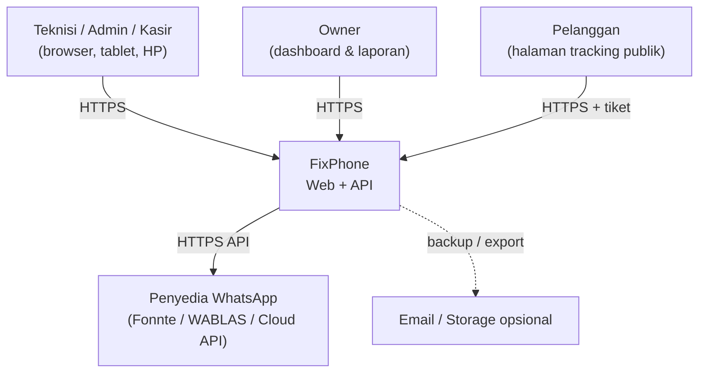
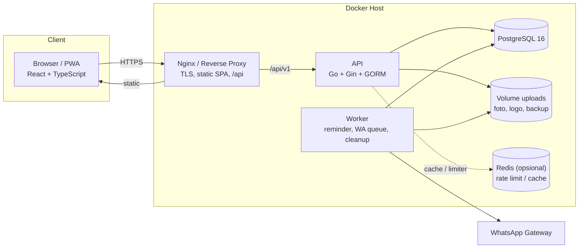
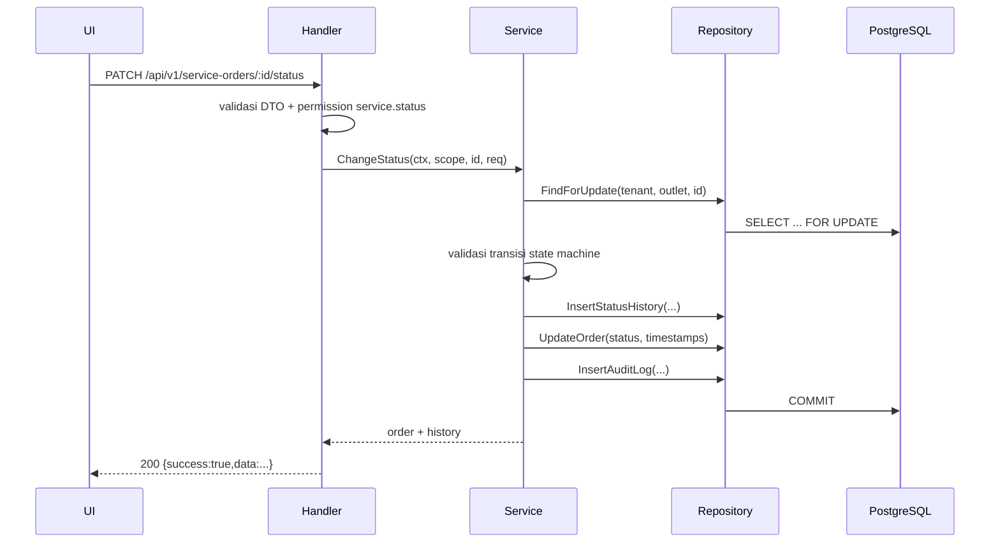
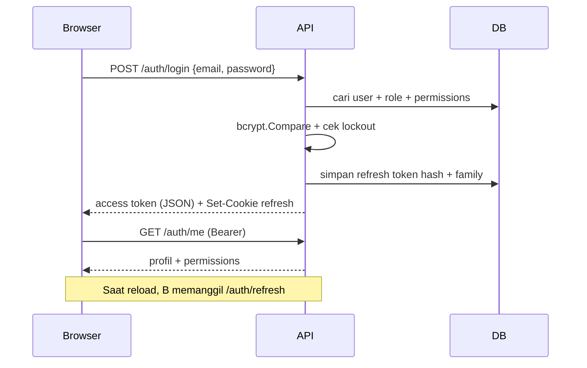
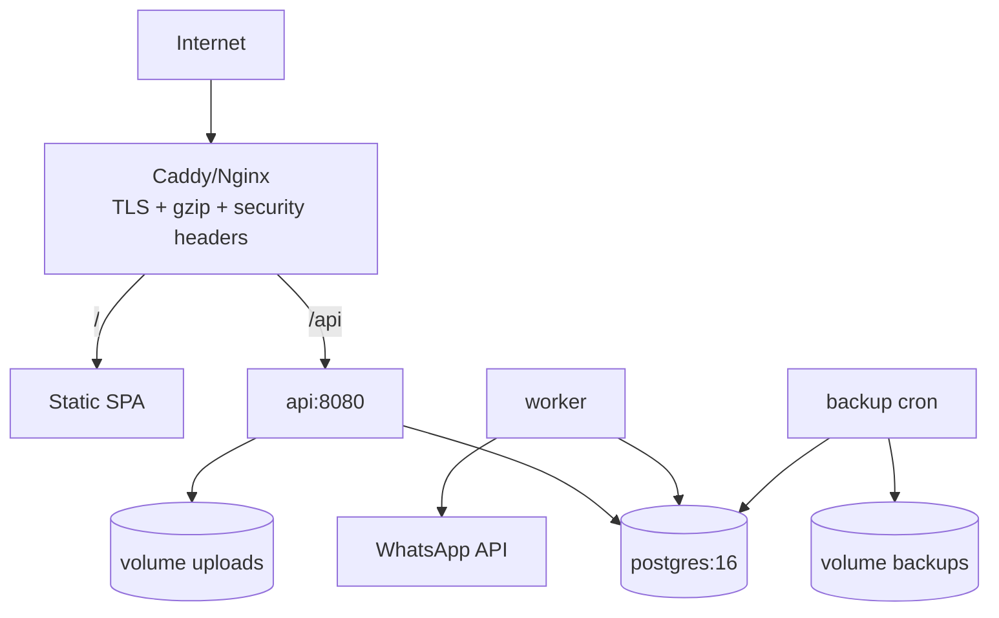

# 02 — Arsitektur Sistem

**Versi:** 1.0 (Tahap 1) · **Acuan:** `01-analisis-kebutuhan.md`

---

## 1. Prinsip Arsitektur

1. **Modular monolith** — satu deployable API, batas modul jelas, siap dipecah
   menjadi service bila perlu.
2. **API-first** — seluruh fitur UI memakai REST API yang sama; tidak ada logika
   bisnis di frontend.
3. **Tenant-aware by design** — setiap query transaksional wajib ter-scope tenant
   dan outlet.
4. **Fail closed** — jika scope tenant/izin tidak dapat diverifikasi, request ditolak.
5. **Uang & stok tidak boleh salah** — semua operasi kritis memakai transaksi
   database, row lock, dan constraint.
6. **Auditable** — perubahan status, uang, stok, dan hak akses selalu tercatat.
7. **Sederhana untuk dioperasikan** — satu compose stack, satu perintah migrasi,
   backup otomatis.
8. **UI untuk teknisi** — alur pendek, target sentuh besar, bahasa Indonesia,
   bisa dipakai dari HP.

---

## 2. Context Diagram (C4 Level 1)



---

## 3. Container Diagram



MVP hanya membutuhkan Nginx + API + Worker + PostgreSQL + volume. Redis
opsional; rate limiter default in-memory per instance, ditingkatkan ke Redis
saat horizontal scaling.

---

## 4. Backend — Layered Modular Monolith

```
HTTP Request
   │
   ▼
[Router] → [Middleware chain] → [Handler] → [Service] → [Repository] → PostgreSQL
                                   │            │
                                   │            └── domain rules, transaction
                                   └── validasi DTO, mapping response
```

### 4.1 Aturan dependensi

| Layer | Boleh bergantung pada | Tidak boleh |
|---|---|---|
| `handler` | `service`, `dto`, `pkg/response` | `repository`, `gorm` langsung |
| `service` | `repository`, domain lain via interface, `pkg` | `gin.Context` |
| `repository` | `gorm`, model | `service`, `handler` |
| `model` | — | layer lain |
| `pkg` | stdlib/library | domain module |

Service menerima `context.Context` dan `TenantScope` eksplisit. Tidak ada
`gin.Context` yang bocor ke service agar mudah diuji dan dipakai worker.

### 4.2 Anatomi satu modul

```
internal/modules/service/
├── model.go        # entitas GORM + konstanta status
├── dto.go          # request/response + binding tag
├── repository.go   # query ter-scope tenant, lock, agregasi
├── service.go      # aturan bisnis, state machine, transaksi
├── handler.go      # HTTP binding, validasi, response
├── routes.go       # registrasi endpoint + permission
└── service_test.go # unit/integration test modul
```

Modul yang saling membutuhkan (mis. `service` butuh `inventory`) memakai
**interface kecil** yang didefinisikan di sisi pemakai, bukan import paket
repository modul lain secara langsung.

### 4.3 Middleware chain (urutan)

1. `RequestID` — menghasilkan/meneruskan `X-Request-ID`.
2. `Recovery` — panic → 500 + log, tanpa stack trace ke klien.
3. `Logger` — structured JSON (method, path, status, durasi, user, tenant).
4. `CORS` — origin eksplisit dari env, credentials hanya bila diperlukan.
5. `BodyLimit` — maksimum 1 MB JSON / 25 MB multipart.
6. `RateLimit` — per IP untuk endpoint publik, per user untuk endpoint auth.
7. `Auth` — verifikasi JWT access token.
8. `Tenant` — memuat tenant aktif, memvalidasi status langganan/aktif.
9. `OutletScope` — memvalidasi `X-Outlet-Id`/query outlet terhadap akses user.
10. `RequirePermission` — dicek per route.
11. `AuditContext` — menyiapkan actor & request ID untuk audit log.

### 4.4 Request lifecycle (contoh: ubah status servis)



Semua perubahan status, stok, dan pembayaran menggunakan **satu transaksi
database** yang mencakup history, audit, dan mutasi terkait.

---

## 5. Multi-Tenancy & Multi-Outlet

### 5.1 Keputusan

**Shared database, shared schema, kolom `tenant_id` + `outlet_id`.**
Alasan: sederhana untuk MVP, biaya operasional rendah, migrasi sekali untuk
semua tenant, cukup untuk ribuan tenant dengan index yang benar.

Alternatif yang ditolak:
- *Schema per tenant* — migrasi N schema, connection pool rumit.
- *Database per tenant* — biaya & operasional tinggi untuk SaaS awal.

### 5.2 Penegakan isolasi (berlapis)

1. **Repository scope wajib** — semua method transaksional menerima
   `TenantScope{TenantID, OutletIDs, IsOwner}` dan menambahkan `WHERE tenant_id`.
   Tidak ada method "tanpa scope" kecuali untuk super admin/platform.
2. **JWT claims** — `sub`, `tid`, `role`, `sid`. Tenant tidak boleh diambil dari
   body/query.
3. **Validasi referensi** — setiap ID relasi (customer, sparepart, teknisi)
   diverifikasi milik tenant yang sama.
4. **Defense in depth (Tahap 11)** — PostgreSQL Row Level Security pada tabel
   transaksional, dengan `SET LOCAL app.tenant_id` per transaksi.
5. **Test isolasi** — integration test wajib membuktikan tenant A tidak bisa
   membaca/mengubah data tenant B (IDOR).

### 5.3 Outlet

- Owner melihat semua outlet dalam tenant.
- Admin/Kasir/Teknisi dibatasi `user_outlets`; request menyertakan outlet aktif.
- Data transaksional menyimpan `outlet_id` untuk laporan dan nomor dokumen.
- Pengguna dengan > 1 outlet memilih outlet aktif di topbar; pilihan disimpan
  di localStorage dan divalidasi server pada setiap request.

---

## 6. Autentikasi & Otorisasi

### 6.1 Token

| Token | Format | Umur | Penyimpanan klien |
|---|---|---|---|
| Access | JWT HS256 (claims: sub, tid, role, sid, iat, exp) | 15 menit | Memori (Zustand), tidak di localStorage |
| Refresh | Opaque 256-bit acak, disimpan **hash SHA-256** di DB | 30 hari | Cookie `HttpOnly; Secure; SameSite=Strict; Path=/api/v1/auth` |

- Rotasi refresh token setiap refresh; token lama ditandai `revoked_at` dan
  `replaced_by`. Penggunaan token yang sudah dipakai → cabut seluruh family
  (deteksi pencurian).
- Logout mencabut refresh token aktif dan menghapus cookie.
- Ganti password mencabut semua refresh token pengguna.
- JWT secret minimal 32 byte dari env; key rotation via `kid` disiapkan.

### 6.2 Login flow



### 6.3 Permission

- Permission berupa string `module.action` (contoh `payment.create`).
- Route mendeklarasikan permission yang dibutuhkan.
- Permission diambil dari role dan di-cache 5 menit per user; perubahan role
  menaikkan `permission_version` sehingga cache invalid.
- Pengecekan tambahan level data (assigned technician, outlet) dilakukan di
  service, bukan hanya route.

---

## 7. Mesin Status Servis

State machine didefinisikan sebagai data, bukan `if` bersarang:

```go
var allowedTransitions = map[Status][]Status{
    StatusReceived:        {StatusWaitingDiagnosis, StatusCancelled},
    StatusWaitingDiagnosis:{StatusWaitingApproval, StatusWaitingPart, StatusInProgress, StatusCancelled},
    // ...
}
```

Service `ChangeStatus` melakukan:
1. Lock baris order.
2. Validasi transisi + permission khusus status tujuan.
3. Efek samping sesuai transisi (mis. `completed` → set `completed_at`,
   buat draft invoice; `picked_up` → set `picked_up_at`, aktifkan garansi,
   hapus kredensial perangkat setelah 30 hari via worker).
4. Insert history + audit.
5. Commit, lalu enqueue notifikasi WA (di luar transaksi, best effort dengan
   outbox pattern `whatsapp_messages`).

---

## 8. Penomoran Dokumen & Konkurensi

Nomor tiket/invoice/klaim/pengeluaran dibuat oleh tabel `document_sequences`:

```sql
INSERT INTO document_sequences (tenant_id, outlet_id, doc_type, period_key, last_number)
VALUES ($1, $2, 'service_order', '20261103', 1)
ON CONFLICT (tenant_id, outlet_id, doc_type, period_key)
DO UPDATE SET last_number = document_sequences.last_number + 1, updated_at = now()
RETURNING last_number;
```

- Unik per `(tenant, outlet, doc_type, period_key)`.
- `period_key` mengikuti timezone outlet (`YYYYMMDD` untuk tiket/invoice).
- Format akhir dari `business_settings` (prefix, jumlah digit, pemisah).
- Unique constraint pada `ticket_no`/`invoice_no` menjadi pengaman terakhir.

**Stok:** `UPDATE spareparts SET stock = stock - $qty WHERE id=$id AND stock >= $qty
RETURNING stock` di dalam transaksi; jika 0 baris → `409 INSUFFICIENT_STOCK`.
`inventory_movements` mencatat `stock_before`/`stock_after`.

---

## 9. Frontend Architecture

SPA React + Vite, di-serve sebagai static oleh Nginx.

```
src/
├── app/           # router, providers, error boundary
├── components/    # ui (shadcn), layout, shared (DataTable, StatusBadge, ...)
├── features/      # per domain: api, hooks, components, pages, schemas
├── lib/           # api client, auth, permissions, format, utils
├── stores/        # auth (memory), ui (sidebar, outlet aktif)
├── types/         # tipe API bersama
└── styles/        # tailwind, print.css
```

- **TanStack Query** untuk server state (cache, invalidasi setelah mutasi).
- **Zustand** hanya untuk state klien (sesi, sidebar, outlet aktif).
- **React Hook Form + Zod** untuk form; skema Zod mencerminkan validasi backend.
- **Axios instance** menambahkan Bearer token, `X-Outlet-Id`, `X-Request-ID`;
  interceptor 401 mencoba refresh sekali lalu logout.
- **PermissionGuard** menyembunyikan aksi yang tidak diizinkan; server tetap
  menjadi otoritas akhir.
- **Route lazy loading** per fitur; skeleton loading; error boundary per halaman.
- **PWA** memakai `vite-plugin-pwa` (manifest, ikon, cache app shell). Tidak ada
  mutasi offline pada MVP.
- **Print** memakai route terpisah `/print/*` dengan CSS `@page` (A4, 58 mm, 80 mm).

---

## 10. Upload & Penyimpanan File

- Endpoint multipart terautentikasi; validasi ukuran (5 MB) dan MIME
  (`image/jpeg`, `image/png`, `image/webp`) dengan **magic bytes**, bukan hanya
  ekstensi.
- Nama file diacak (UUIDv7 + ekstensi), disimpan di volume
  `uploads/{tenant_id}/{yyyy}/{mm}/`.
- Tidak disajikan langsung oleh Nginx; diakses via endpoint yang memeriksa
  tenant & permission, atau signed URL berumur pendek.
- Foto intake/before/after tidak pernah tampil di halaman tracking publik
  kecuali diaktifkan eksplisit oleh Owner.
- Adapter storage: `local` (MVP) dan `s3` (pasca-MVP) melalui interface yang sama.

---

## 11. Notifikasi WhatsApp

- Tabel `whatsapp_messages` berperan sebagai **outbox** (status `queued`,
  `processing`, `sent`, `failed`, `cancelled`).
- Worker mengambil batch dengan `FOR UPDATE SKIP LOCKED`, mengirim via adapter,
  mencatat respons, dan retry dengan exponential backoff (maks 3×).
- Adapter: `noop` (default dev, hanya log), `fonnte`, `wablas`, `cloud_api`.
- Template pesan disimpan di settings dengan placeholder tervalidasi
  (`{customer_name}`, `{ticket_no}`, `{status}`, `{total}`, `{tracking_url}`).
- Tanpa kredensial gateway, UI menyediakan tombol **"Chat via WhatsApp"**
  (`https://wa.me/62...?text=...`) yang benar-benar membuka WhatsApp — bukan
  tombol kosong.

---

## 12. Deployment Topology



- Satu `docker-compose.yml` untuk production: `postgres`, `api`, `worker`,
  `web`, `backup` (opsional profile), `caddy` (opsional TLS).
- Migrasi dijalankan oleh service one-shot `migrate` sebelum `api` start
  (`depends_on: condition: service_completed_successfully`).
- Health check: `/healthz` (liveness) dan `/readyz` (DB ping + migrasi versi).
- Log ke stdout (JSON), dirotasi oleh Docker.
- Konfigurasi melalui env; tidak ada secret di image.
- Backup harian: `pg_dump -Fc` + tar volume uploads, retensi 30 harian/12 bulanan,
  skrip restore terdokumentasi dan diuji.

### 12.1 Environment variables (rencana)

| Variabel | Contoh | Catatan |
|---|---|---|
| `APP_ENV` | `production` | `development`, `test`, `production` |
| `APP_PORT` | `8080` | |
| `APP_BASE_URL` | `https://fixphone.example.com` | Untuk link tracking |
| `DB_DSN` | `postgres://...` | Wajib TLS di production terkelola |
| `JWT_SECRET` | 64 char acak | Rotasi via `JWT_SECRET_PREVIOUS` |
| `APP_ENC_KEY` | base64 32 byte | Enkripsi PIN perangkat & kredensial WA |
| `CORS_ORIGINS` | `https://fixphone.example.com` | Daftar eksplisit |
| `UPLOAD_DIR` | `/data/uploads` | Volume |
| `UPLOAD_MAX_MB` | `5` | |
| `WA_FONNTE_TOKEN` | — | Token adapter Fonnte; provider aktif dibaca dari `business_settings.wa_provider` |
| `WA_WABLAS_TOKEN` | — | Token adapter Wablas |
| `WA_WABLAS_SECRET` | — | Opsional, digabung sebagai `token.secret` |
| `WA_WABLAS_URL` | `https://console.wablas.com` | Base URL API Wablas |
| `WORKER_OUTBOX_INTERVAL` | `30s` | Interval drain outbox WhatsApp |
| `WORKER_REMINDER_INTERVAL` | `15m` | Interval reminder servis/garansi |
| `WORKER_PURGE_INTERVAL` | `1h` | Interval purge kredensial perangkat |
| `BACKUP_DIR` | `/data/backups` | |
| `LOG_LEVEL` | `info` | |
| `TZ` | `Asia/Jakarta` | Hanya default; perhitungan bisnis per outlet |

---

## 13. Observability & Operasional

- **Log terstruktur** (`log/slog`, JSON): timestamp, level, request_id,
  tenant_id, user_id, method, path, status, latency, error_code.
- **Request ID** dikembalikan di header dan response error untuk investigasi.
- **Metrics minimum** (pasca-MVP): request count/latency, error rate, job queue
  depth, DB pool. Endpoint `/metrics` dilindungi.
- **Audit log** bukan log teknis; disimpan di DB, append-only, retensi 1 tahun.
- **Alert**: kegagalan backup, error rate > 5%, disk > 80%, worker macet.
- **Runbook**: start/stop, migrasi, restore, rotasi secret, pembuatan tenant.

---

## 14. Keputusan Arsitektur (ADR)

| ID | Keputusan | Alasan | Konsekuensi |
|---|---|---|---|
| ADR-001 | Modular monolith, bukan microservices | Tim kecil, domain saling terkait, operasional sederhana | Batas modul harus disiplin; siap dipecah nanti |
| ADR-002 | Shared schema multi-tenant | Migrasi & biaya rendah | Wajib scope tenant + RLS di tahap hardening |
| ADR-003 | UUIDv7 sebagai PK | Tidak mudah ditebak, terurut waktu (index baik) | 16 byte vs 8 byte bigint |
| ADR-004 | SQL migration (golang-migrate), bukan AutoMigrate | Kontrol penuh, reviewable, aman di production | Perlu disiplin file migrasi |
| ADR-005 | JWT access pendek + refresh rotasi | Stateless API + keamanan sesi | Perlu penanganan reuse detection |
| ADR-006 | Uang BIGINT rupiah | Menghindari error floating point | Tidak multi-currency di MVP |
| ADR-007 | `varchar + CHECK` untuk enum | Mudah tambah nilai tanpa `ALTER TYPE` yang rumit | Validasi tetap di aplikasi |
| ADR-008 | GORM untuk CRUD, raw SQL untuk lock/agregasi | Produktivitas + kontrol query kritis | Dua gaya query, harus konsisten |
| ADR-009 | Vite SPA + PWA, bukan SSR | Aplikasi internal, tidak butuh SEO; deploy statis | Halaman tracking publik tetap CSR (cepat & sederhana) |
| ADR-010 | Tailwind + shadcn/ui | Konsisten, aksesibel, mudah dikustomisasi | Perlu disiplin token desain |
| ADR-011 | Local storage file + adapter S3 | MVP tanpa ketergantungan cloud | Backup volume wajib |
| ADR-012 | WhatsApp adapter + outbox | Provider mudah diganti, tidak blocking transaksi | Worker wajib berjalan |
| ADR-013 | State machine eksplisit | Mencegah status ilegal & mudah diuji | Daftar transisi harus dipelihara |
| ADR-014 | Enkripsi kredensial perangkat di aplikasi | Kontrol kunci & audit lebih baik dari plaintext | Kehilangan `APP_ENC_KEY` = data tidak terbaca (backup kunci!) |

---

## 15. Batasan & Non-Goals MVP

- Tidak ada akuntansi double-entry, payroll, atau CRM lanjutan.
- Tidak ada aplikasi mobile native.
- Tidak ada sinkronisasi offline penuh.
- Tidak ada billing SaaS otomatis (tenant dibuat manual oleh Super Admin).
- Tidak ada integrasi payment gateway/QRIS dinamis.
- Tidak ada AI diagnosis.

---

## 16. Definition of Done Arsitektur

- [x] Pembagian modul dan aturan dependensi disepakati.
- [x] Strategi multi-tenant & multi-outlet ditetapkan.
- [x] Mekanisme auth, RBAC, dan audit ditetapkan.
- [x] Strategi konkurensi nomor dokumen & stok ditetapkan.
- [x] Topologi deployment & backup ditetapkan.
- [ ] Divalidasi melalui implementasi pada Tahap 2–12.
