# 03 — Desain Database

**Versi:** 1.0 (Tahap 1) · **DBMS:** PostgreSQL 16 · **ORM:** GORM
**Tujuan:** desain logis & fisik yang menjamin isolasi tenant, akurasi uang/stok,
jejak audit, dan performa laporan.

> File migrasi SQL eksekutabel dibuat pada **Tahap 2**. Dokumen ini adalah
> rancangan yang menjadi acuan migrasi tersebut.

---

## 1. Konvensi

| Aspek | Ketentuan |
|---|---|
| Nama tabel | `snake_case`, jamak (`service_orders`) |
| Primary key | `id uuid` (UUIDv7 dibuat aplikasi, default `gen_random_uuid()` sebagai fallback) |
| Waktu | `timestamptz`, disimpan UTC |
| Uang | `BIGINT` rupiah, tanpa desimal, `CHECK (>= 0)` bila relevan |
| Kuantitas | `NUMERIC(12,2)` untuk jasa; `INTEGER` untuk stok sparepart |
| Boolean | `boolean NOT NULL DEFAULT false` |
| Enum | `VARCHAR` + `CHECK (col IN (...))` (mudah evolusi) |
| Soft delete | `deleted_at timestamptz NULL` hanya untuk data master |
| Audit kolom | `created_at`, `updated_at`, `created_by`, `updated_by` |
| Tenant | `tenant_id NOT NULL` pada semua tabel bisnis; `outlet_id` pada data operasional |
| Naming constraint | `pk_`, `fk_`, `uq_`, `idx_`, `chk_` + nama tabel |
| Case | lowercase, tanpa reserved word |

### Kolom standar

```sql
created_at timestamptz NOT NULL DEFAULT now(),
updated_at timestamptz NOT NULL DEFAULT now(),
created_by uuid NULL REFERENCES users(id) ON DELETE SET NULL,
updated_by uuid NULL REFERENCES users(id) ON DELETE SET NULL
```

Tabel append-only (`audit_logs`, `inventory_movements`, `service_status_history`,
`payments` setelah posted) tidak memiliki `updated_at`/`deleted_at`.

---

## 2. ERD

```mermaid
erDiagram
  TENANTS ||--o{ OUTLETS : "memiliki"
  TENANTS ||--o{ USERS : "memiliki"
  TENANTS ||--o{ CUSTOMERS : "memiliki"
  TENANTS ||--o{ SERVICE_ORDERS : "memiliki"
  TENANTS ||--o{ SPAREPARTS : "memiliki"
  TENANTS ||--o{ EXPENSES : "memiliki"
  TENANTS ||--o{ BUSINESS_SETTINGS : "memiliki"
  TENANTS ||--o{ DOCUMENT_SEQUENCES : "memiliki"
  TENANTS ||--o{ AUDIT_LOGS : "memiliki"
  TENANTS ||--o{ WHATSAPP_MESSAGES : "memiliki"

  ROLES ||--o{ USERS : "role"
  ROLES ||--o{ ROLE_PERMISSIONS : "memiliki"
  PERMISSIONS ||--o{ ROLE_PERMISSIONS : "dimiliki"
  USERS ||--o{ USER_OUTLETS : "ditugaskan"
  OUTLETS ||--o{ USER_OUTLETS : "anggota"
  USERS ||--o{ REFRESH_TOKENS : "sesi"
  USERS ||--o{ NOTIFICATIONS : "menerima"

  CUSTOMERS ||--o{ DEVICES : "memiliki"
  CUSTOMERS ||--o{ SERVICE_ORDERS : "membuka"
  DEVICES ||--o{ SERVICE_ORDERS : "dilayani"
  OUTLETS ||--o{ SERVICE_ORDERS : "lokasi"

  SERVICE_ORDERS ||--o{ SERVICE_ORDER_ITEMS : "rincian"
  SERVICE_ORDERS ||--|| SERVICE_DIAGNOSTICS : "diagnosis"
  SERVICE_ORDERS ||--o{ SERVICE_STATUS_HISTORY : "riwayat"
  SERVICE_ORDERS ||--o{ SERVICE_PHOTOS : "foto"
  SERVICE_ORDERS ||--|| INVOICES : "tagihan"
  SERVICE_ORDERS ||--|| WARRANTIES : "garansi"
  SERVICE_ORDERS ||--o{ WHATSAPP_MESSAGES : "notifikasi"

  INVOICES ||--o{ INVOICE_ITEMS : "rincian"
  INVOICES ||--o{ PAYMENTS : "pembayaran"

  SPAREPART_CATEGORIES ||--o{ SPAREPARTS : "kategori"
  SUPPLIERS ||--o{ SPAREPARTS : "supplier"
  SPAREPARTS ||--o{ SERVICE_ORDER_ITEMS : "dipakai"
  SPAREPARTS ||--o{ INVENTORY_MOVEMENTS : "mutasi"

  WARRANTIES ||--o{ WARRANTY_CLAIMS : "klaim"
  EXPENSE_CATEGORIES ||--o{ EXPENSES : "kategori"

  TENANTS {
    uuid id PK
    varchar name
    varchar slug UK
    varchar status
    timestamptz created_at
  }
  OUTLETS {
    uuid id PK
    uuid tenant_id FK
    varchar code
    varchar name
    varchar timezone
    boolean is_active
  }
  USERS {
    uuid id PK
    uuid tenant_id FK
    uuid role_id FK
    varchar name
    varchar email UK
    varchar password_hash
    boolean is_active
    timestamptz locked_until
  }
  ROLES {
    uuid id PK
    varchar slug UK
    varchar name
    boolean is_system
  }
  PERMISSIONS {
    uuid id PK
    varchar code UK
    varchar module
  }
  ROLE_PERMISSIONS {
    uuid role_id PK
    uuid permission_id PK
  }
  USER_OUTLETS {
    uuid user_id PK
    uuid outlet_id PK
  }
  REFRESH_TOKENS {
    uuid id PK
    uuid user_id FK
    char token_hash UK
    timestamptz expires_at
    timestamptz revoked_at
  }
  BUSINESS_SETTINGS {
    uuid id PK
    uuid tenant_id FK
    uuid outlet_id FK
    varchar store_name
    varchar ticket_format
    varchar invoice_format
  }
  DOCUMENT_SEQUENCES {
    uuid id PK
    uuid tenant_id FK
    uuid outlet_id FK
    varchar doc_type
    varchar period_key
    integer last_number
  }
  AUDIT_LOGS {
    bigint id PK
    uuid tenant_id FK
    uuid user_id
    varchar action
    varchar entity_type
    uuid entity_id
    jsonb before_data
    jsonb after_data
    timestamptz created_at
  }
  CUSTOMERS {
    uuid id PK
    uuid tenant_id FK
    varchar name
    varchar phone
    varchar phone_normalized
    text address
    timestamptz deleted_at
  }
  DEVICES {
    uuid id PK
    uuid tenant_id FK
    uuid customer_id FK
    varchar brand
    varchar model
    varchar imei
    varchar color
  }
  SERVICE_ORDERS {
    uuid id PK
    uuid tenant_id FK
    uuid outlet_id FK
    uuid customer_id FK
    uuid device_id FK
    uuid assigned_technician_id FK
    varchar ticket_no UK
    varchar status
    varchar priority
    text complaint
    bigint estimated_cost
    timestamptz estimated_done_at
    timestamptz picked_up_at
    bytea credential_enc
    char public_token UK
  }
  SERVICE_ORDER_ITEMS {
    uuid id PK
    uuid service_order_id FK
    uuid sparepart_id FK
    varchar item_type
    varchar description
    numeric qty
    bigint unit_price
    bigint cost_price
    bigint subtotal
  }
  SERVICE_DIAGNOSTICS {
    uuid id PK
    uuid service_order_id FK
    text diagnosis
    text findings
    text action_taken
    text test_result
    text technician_notes
  }
  SERVICE_STATUS_HISTORY {
    uuid id PK
    uuid service_order_id FK
    varchar from_status
    varchar to_status
    text notes
    uuid changed_by
    timestamptz created_at
  }
  SERVICE_PHOTOS {
    uuid id PK
    uuid service_order_id FK
    varchar stage
    varchar file_path
    boolean is_public
  }
  SPAREPART_CATEGORIES {
    uuid id PK
    uuid tenant_id FK
    varchar name
  }
  SUPPLIERS {
    uuid id PK
    uuid tenant_id FK
    varchar name
    varchar phone
  }
  SPAREPARTS {
    uuid id PK
    uuid tenant_id FK
    uuid category_id FK
    uuid supplier_id FK
    varchar sku UK
    varchar name
    integer stock
    integer min_stock
    bigint cost_price
    bigint sell_price
    boolean is_active
  }
  INVENTORY_MOVEMENTS {
    uuid id PK
    uuid tenant_id FK
    uuid sparepart_id FK
    varchar movement_type
    integer qty
    integer stock_before
    integer stock_after
    varchar reference_type
    uuid reference_id
  }
  INVOICES {
    uuid id PK
    uuid tenant_id FK
    uuid service_order_id FK
    varchar invoice_no UK
    varchar status
    bigint total_amount
    bigint paid_amount
    bigint remaining_amount
  }
  INVOICE_ITEMS {
    uuid id PK
    uuid invoice_id FK
    varchar item_type
    varchar description
    numeric qty
    bigint unit_price
    bigint subtotal
  }
  PAYMENTS {
    uuid id PK
    uuid invoice_id FK
    varchar payment_no UK
    varchar method
    bigint amount
    varchar status
    timestamptz paid_at
  }
  WARRANTIES {
    uuid id PK
    uuid service_order_id FK
    uuid invoice_id FK
    varchar warranty_no UK
    varchar type
    date start_date
    date end_date
    varchar status
  }
  WARRANTY_CLAIMS {
    uuid id PK
    uuid warranty_id FK
    uuid rework_service_order_id FK
    varchar claim_no UK
    varchar status
    text resolution
  }
  EXPENSE_CATEGORIES {
    uuid id PK
    uuid tenant_id FK
    varchar name
  }
  EXPENSES {
    uuid id PK
    uuid tenant_id FK
    uuid outlet_id FK
    varchar expense_no UK
    bigint amount
    date expense_date
  }
  WHATSAPP_MESSAGES {
    uuid id PK
    uuid tenant_id FK
    uuid service_order_id FK
    varchar phone
    varchar template_key
    varchar status
    integer attempts
  }
  NOTIFICATIONS {
    uuid id PK
    uuid user_id FK
    varchar type
    varchar title
    boolean is_read
  }
```



---

## 3. Kamus Tabel

### 3.1 Platform & Identitas

#### `tenants`

| Kolom | Tipe | Constraint | Keterangan |
|---|---|---|---|
| `id` | uuid | PK | |
| `name` | varchar(150) | NOT NULL | Nama badan usaha |
| `slug` | varchar(60) | UNIQUE, NOT NULL | Subdomain/identifier |
| `status` | varchar(20) | NOT NULL, CHECK `active/suspended/trial` | |
| `plan` | varchar(20) | NOT NULL DEFAULT `free` | `free/starter/pro` (fase SaaS) |
| `trial_ends_at` | timestamptz | NULL | |
| `owner_name` | varchar(150) | NULL | Kontak PIC |
| `owner_phone` | varchar(30) | NULL | |
| `created_at` | timestamptz | NOT NULL | |
| `updated_at` | timestamptz | NOT NULL | |

#### `outlets`

| Kolom | Tipe | Constraint | Keterangan |
|---|---|---|---|
| `id` | uuid | PK | |
| `tenant_id` | uuid | FK → tenants, NOT NULL | |
| `code` | varchar(20) | NOT NULL | Unik per tenant |
| `name` | varchar(120) | NOT NULL | |
| `address` | text | NULL | |
| `phone` | varchar(30) | NULL | |
| `timezone` | varchar(50) | NOT NULL DEFAULT `Asia/Jakarta` | Dasar "hari ini" & nomor dokumen |
| `is_active` | boolean | NOT NULL DEFAULT true | |
| `created_at/updated_at` | timestamptz | NOT NULL | |

Constraint: `UNIQUE (tenant_id, code)`.

#### `roles`

| Kolom | Tipe | Constraint |
|---|---|---|
| `id` | uuid | PK |
| `slug` | varchar(30) | UNIQUE: `super_admin`, `owner`, `admin`, `technician`, `cashier` |
| `name` | varchar(60) | NOT NULL |
| `is_system` | boolean | NOT NULL DEFAULT true |
| `created_at` | timestamptz | NOT NULL |

#### `permissions`

| Kolom | Tipe | Constraint |
|---|---|---|
| `id` | uuid | PK |
| `code` | varchar(80) | UNIQUE, format `module.action` |
| `module` | varchar(40) | NOT NULL |
| `description` | varchar(200) | NULL |

#### `role_permissions`

`role_id uuid FK`, `permission_id uuid FK`, PK gabungan. Seed pada Tahap 3.

#### `users`

| Kolom | Tipe | Constraint | Keterangan |
|---|---|---|---|
| `id` | uuid | PK | |
| `tenant_id` | uuid | FK → tenants, NULL untuk `super_admin` | |
| `role_id` | uuid | FK → roles, NOT NULL | |
| `name` | varchar(120) | NOT NULL | |
| `email` | varchar(150) | UNIQUE, NOT NULL | Login; unik global MVP |
| `phone` | varchar(30) | NULL | |
| `password_hash` | varchar(100) | NOT NULL | bcrypt cost 12 |
| `avatar_path` | varchar(255) | NULL | |
| `is_active` | boolean | NOT NULL DEFAULT true | |
| `failed_login_count` | smallint | NOT NULL DEFAULT 0 | |
| `locked_until` | timestamptz | NULL | Lockout 15 menit |
| `last_login_at` | timestamptz | NULL | |
| `permission_version` | integer | NOT NULL DEFAULT 1 | Invalidasi cache izin |
| `deleted_at` | timestamptz | NULL | Soft delete |
| `created_at/updated_at` | timestamptz | NOT NULL | |

Index: `(tenant_id, is_active)`, `UNIQUE (email) WHERE deleted_at IS NULL` (partial),
`idx_users_tenant_role`.

#### `user_outlets`

`user_id uuid FK`, `outlet_id uuid FK`, `created_at`, PK gabungan.
Owner tidak wajib memiliki baris (akses semua outlet tenant).

#### `refresh_tokens`

| Kolom | Tipe | Constraint |
|---|---|---|
| `id` | uuid | PK |
| `user_id` | uuid | FK → users ON DELETE CASCADE |
| `token_hash` | char(64) | UNIQUE (SHA-256 hex) |
| `family_id` | uuid | NOT NULL (deteksi reuse) |
| `expires_at` | timestamptz | NOT NULL |
| `revoked_at` | timestamptz | NULL |
| `replaced_by_id` | uuid | NULL FK → refresh_tokens |
| `ip` | inet | NULL |
| `user_agent` | varchar(255) | NULL |
| `created_at` | timestamptz | NOT NULL |

Index: `(user_id)`, `(family_id)`, partial `(expires_at) WHERE revoked_at IS NULL`.

#### `business_settings`

Satu baris per tenant (`outlet_id NULL`) dan opsional override per outlet.

| Kolom | Tipe | Keterangan |
|---|---|---|
| `id` | uuid PK | |
| `tenant_id` | uuid FK | |
| `outlet_id` | uuid FK NULL | NULL = default tenant |
| `store_name` | varchar(150) | Nama tampil di invoice |
| `legal_name` | varchar(150) NULL | |
| `logo_path` | varchar(255) NULL | |
| `address` / `phone` / `email` | text/varchar | |
| `tax_id` | varchar(30) NULL | NPWP |
| `currency` | char(3) DEFAULT `IDR` | |
| `timezone` | varchar(50) | Default outlet |
| `ticket_prefix` | varchar(10) DEFAULT `FP` | |
| `ticket_format` | varchar(60) DEFAULT `{PREFIX}-{YYMMDD}-{SEQ:4}` | |
| `invoice_prefix` | varchar(10) DEFAULT `INV` | |
| `invoice_format` | varchar(60) DEFAULT `{PREFIX}-{YYMMDD}-{SEQ:4}` | |
| `invoice_terms` | text NULL | |
| `invoice_footer` | text NULL | |
| `default_service_warranty_days` | integer DEFAULT 30 | |
| `default_part_warranty_days` | integer DEFAULT 90 | |
| `receipt_paper_width` | smallint DEFAULT 58 | CHECK 58/80 |
| `technician_sees_only_assigned` | boolean DEFAULT true | |
| `public_tracking_enabled` | boolean DEFAULT true | |
| `wa_provider` | varchar(20) DEFAULT `noop` | |
| `wa_config_enc` | bytea NULL | Kredensial gateway terenkripsi |
| `wa_templates` | jsonb DEFAULT `{}` | Template pesan |
| `created_at/updated_at` | timestamptz | |

Constraint: `UNIQUE NULLS NOT DISTINCT (tenant_id, outlet_id)`.

#### `document_sequences`

| Kolom | Tipe | Constraint |
|---|---|---|
| `id` | uuid | PK |
| `tenant_id` | uuid | FK |
| `outlet_id` | uuid | FK |
| `doc_type` | varchar(30) | `service_order`, `invoice`, `payment`, `expense`, `warranty`, `claim` |
| `period_key` | varchar(10) | `YYYYMMDD` / `YYYYMM` |
| `last_number` | integer | NOT NULL DEFAULT 0 |
| `updated_at` | timestamptz | NOT NULL |

`UNIQUE (tenant_id, outlet_id, doc_type, period_key)`.

#### `audit_logs` (append-only)

| Kolom | Tipe | Keterangan |
|---|---|---|
| `id` | bigint GENERATED ALWAYS AS IDENTITY PK | Urut waktu |
| `tenant_id` | uuid NULL | NULL untuk aksi platform |
| `user_id` | uuid NULL | Tanpa FK agar history tetap ada |
| `actor_name` | varchar(120) NULL | Snapshot |
| `action` | varchar(60) | `create`, `update`, `delete`, `status_change`, `login`, `failed_login`, `reveal_credential`, `void_payment`, … |
| `module` | varchar(40) | |
| `entity_type` | varchar(60) | |
| `entity_id` | uuid NULL | |
| `before_data` | jsonb NULL | Diff/redacted |
| `after_data` | jsonb NULL | Diff/redacted |
| `ip` | inet NULL | |
| `user_agent` | varchar(255) NULL | |
| `request_id` | varchar(64) NULL | |
| `created_at` | timestamptz | NOT NULL DEFAULT now() |

Index: `(tenant_id, created_at DESC)`, `(entity_type, entity_id)`,
`(user_id, created_at DESC)`. Retensi 365 hari (job arsip).

### 3.2 Pelanggan & Perangkat

#### `customers`

| Kolom | Tipe | Constraint |
|---|---|---|
| `id` | uuid | PK |
| `tenant_id` | uuid | FK, NOT NULL |
| `name` | varchar(120) | NOT NULL |
| `phone` | varchar(30) | NOT NULL (tampil) |
| `phone_normalized` | varchar(20) | NOT NULL, `62…` |
| `address` | text | NULL |
| `notes` | text | NULL |
| `last_service_at` | timestamptz | NULL (cache, diperbarui service) |
| `deleted_at` | timestamptz | NULL |
| `created_at/updated_at/created_by/updated_by` | | |

Index:
- `UNIQUE (tenant_id, phone_normalized) WHERE deleted_at IS NULL`
- `GIN (name gin_trgm_ops)` — ekstensi `pg_trgm` untuk pencarian.
- `(tenant_id, last_service_at DESC)`.

#### `devices`

| Kolom | Tipe | Constraint |
|---|---|---|
| `id` | uuid | PK |
| `tenant_id` | uuid | FK |
| `customer_id` | uuid | FK → customers |
| `brand` | varchar(60) | NOT NULL |
| `model` | varchar(100) | NOT NULL |
| `imei` | varchar(20) | NULL |
| `color` | varchar(40) | NULL |
| `notes` | text | NULL |
| `deleted_at` | timestamptz | NULL |
| `created_at/updated_at` | | |

Index: `(tenant_id, customer_id)`, `UNIQUE (tenant_id, imei) WHERE imei IS NOT NULL AND deleted_at IS NULL`.

### 3.3 Servis

#### `service_orders`

| Kolom | Tipe | Constraint | Keterangan |
|---|---|---|---|
| `id` | uuid | PK | |
| `tenant_id` | uuid | FK, NOT NULL | |
| `outlet_id` | uuid | FK, NOT NULL | |
| `ticket_no` | varchar(40) | NOT NULL | Unik per tenant |
| `public_token` | char(32) | UNIQUE NULL | Hex 16 byte; URL tracking |
| `public_token_expires_at` | timestamptz | NULL | +90 hari setelah pickup |
| `customer_id` | uuid | FK → customers, NOT NULL | |
| `device_id` | uuid | FK → devices, NULL | |
| `assigned_technician_id` | uuid | FK → users, NULL | |
| `status` | varchar(30) | NOT NULL DEFAULT `received` | 10 status |
| `priority` | varchar(10) | NOT NULL DEFAULT `normal` | `normal/express` |
| `device_brand` | varchar(60) | NOT NULL | Snapshot intake |
| `device_model` | varchar(100) | NOT NULL | Snapshot |
| `device_imei` | varchar(20) | NULL | Snapshot |
| `device_color` | varchar(40) | NULL | |
| `completeness` | text | NULL | Kelengkapan (charger, casing, SIM) |
| `physical_condition` | text | NULL | Kondisi fisik |
| `complaint` | text | NOT NULL | Keluhan pelanggan |
| `notes` | text | NULL | Catatan untuk pelanggan |
| `internal_notes` | text | NULL | Tidak pernah tampil publik |
| `estimated_cost` | bigint | NOT NULL DEFAULT 0, CHECK ≥ 0 | Estimasi awal |
| `estimated_done_at` | timestamptz | NULL | Estimasi selesai |
| `received_at` | timestamptz | NOT NULL DEFAULT now() | |
| `started_at` | timestamptz | NULL | |
| `completed_at` | timestamptz | NULL | |
| `picked_up_at` | timestamptz | NULL | |
| `cancelled_at` | timestamptz | NULL | |
| `cancel_reason` | text | NULL | |
| `credential_type` | varchar(10) | NOT NULL DEFAULT `none` | `none/pin/password/pattern` |
| `credential_enc` | bytea | NULL | AES-256-GCM (version‖nonce‖ciphertext) |
| `credential_key_version` | smallint | NULL | Rotasi kunci |
| `credential_set_at` | timestamptz | NULL | |
| `credential_purge_at` | timestamptz | NULL | Worker hapus setelah pickup + 30 hari |
| `created_by` / `updated_by` | uuid | FK → users, NULL | |
| `created_at/updated_at` | timestamptz | NOT NULL | |

Constraint:
- `UNIQUE (tenant_id, ticket_no)`
- `CHECK (status IN ('received','waiting_diagnosis','waiting_approval','waiting_part','in_progress','testing','completed','ready_for_pickup','picked_up','cancelled'))`
- `CHECK (priority IN ('normal','express'))`
- `CHECK (estimated_cost >= 0)`
- `CHECK (picked_up_at IS NULL OR completed_at IS NOT NULL)`

Index:
- `(tenant_id, outlet_id, status, received_at DESC)` — daftar utama.
- `(tenant_id, ticket_no)` unik.
- `(tenant_id, customer_id, received_at DESC)`.
- `(tenant_id, assigned_technician_id, status)`.
- `(tenant_id, public_token)` unik.
- `(tenant_id, estimated_done_at) WHERE status NOT IN ('picked_up','cancelled')` — reminder.
- `(tenant_id, picked_up_at) WHERE status = 'ready_for_pickup'` — HP belum diambil.

#### `service_order_items`

Baris jasa/sparepart sebelum invoice. Stok sudah dikurangi saat baris sparepart dibuat.

| Kolom | Tipe | Constraint |
|---|---|---|
| `id` | uuid | PK |
| `tenant_id` | uuid | FK |
| `service_order_id` | uuid | FK → service_orders ON DELETE CASCADE |
| `item_type` | varchar(15) | `service/sparepart/custom` |
| `sparepart_id` | uuid | FK → spareparts ON DELETE SET NULL |
| `description` | varchar(200) | NOT NULL (snapshot nama) |
| `qty` | numeric(12,2) | NOT NULL, CHECK > 0 |
| `unit_price` | bigint | NOT NULL, CHECK ≥ 0 |
| `cost_price` | bigint | NOT NULL DEFAULT 0, CHECK ≥ 0 |
| `discount_amount` | bigint | NOT NULL DEFAULT 0, CHECK ≥ 0 |
| `subtotal` | bigint | NOT NULL, CHECK ≥ 0 |
| `warranty_days` | smallint | NOT NULL DEFAULT 0 |
| `added_by` | uuid | FK → users |
| `created_at/updated_at` | timestamptz | |

Check: `subtotal = qty * unit_price - discount_amount` divalidasi di aplikasi
(karena `numeric`), plus `subtotal >= 0`.
Index: `(service_order_id)`, `(tenant_id, sparepart_id)`.

#### `service_diagnostics` (1:1)

| Kolom | Tipe | Keterangan |
|---|---|---|
| `id` | uuid PK | |
| `tenant_id` | uuid FK | |
| `service_order_id` | uuid FK UNIQUE | |
| `diagnosis` | text | Ringkasan kerusakan (bisa ditampilkan publik) |
| `findings` | text | Hasil pemeriksaan detail (internal) |
| `action_taken` | text | Tindakan perbaikan |
| `test_result` | text | Hasil testing |
| `technician_notes` | text | Internal |
| `diagnosed_by` | uuid FK → users | |
| `diagnosed_at` | timestamptz | |
| `estimated_done_at` | timestamptz NULL | |
| `created_at/updated_at` | timestamptz | |

#### `service_status_history` (append-only)

| Kolom | Tipe | Keterangan |
|---|---|---|
| `id` | uuid PK | |
| `tenant_id` | uuid FK | |
| `service_order_id` | uuid FK ON DELETE CASCADE | |
| `from_status` | varchar(30) NULL | NULL = status awal |
| `to_status` | varchar(30) NOT NULL | |
| `notes` | text NULL | |
| `changed_by` | uuid FK → users NULL | NULL = sistem |
| `created_at` | timestamptz NOT NULL | |

Index: `(service_order_id, created_at)`.

#### `service_photos`

| Kolom | Tipe | Keterangan |
|---|---|---|
| `id` | uuid PK | |
| `tenant_id` | uuid FK | |
| `service_order_id` | uuid FK ON DELETE CASCADE | |
| `stage` | varchar(15) | `intake/before/after/testing/other` |
| `file_path` | varchar(255) | Path relatif |
| `mime_type` | varchar(50) | |
| `size_bytes` | integer | |
| `is_public` | boolean DEFAULT false | Tampil di tracking |
| `uploaded_by` | uuid FK → users | |
| `created_at` | timestamptz | |

Index: `(service_order_id, stage)`.

### 3.4 Inventori

#### `sparepart_categories`

`id`, `tenant_id`, `name varchar(80)`, `created_at`, `updated_at`,
`UNIQUE (tenant_id, name)`.

#### `suppliers`

`id`, `tenant_id`, `name varchar(120)`, `contact_name`, `phone`, `address`,
`notes`, `deleted_at`, timestamps. Index `(tenant_id, name)`.

#### `spareparts`

| Kolom | Tipe | Constraint |
|---|---|---|
| `id` | uuid | PK |
| `tenant_id` | uuid | FK |
| `category_id` | uuid | FK → sparepart_categories, NULL |
| `supplier_id` | uuid | FK → suppliers, NULL |
| `sku` | varchar(40) | NOT NULL |
| `barcode` | varchar(60) | NULL |
| `name` | varchar(150) | NOT NULL |
| `compatible_models` | text | NULL (dipisah koma) |
| `stock` | integer | NOT NULL DEFAULT 0, CHECK ≥ 0 |
| `min_stock` | integer | NOT NULL DEFAULT 0, CHECK ≥ 0 |
| `cost_price` | bigint | NOT NULL DEFAULT 0, CHECK ≥ 0 |
| `sell_price` | bigint | NOT NULL DEFAULT 0, CHECK ≥ 0 |
| `location` | varchar(60) | NULL (rak) |
| `image_path` | varchar(255) | NULL |
| `is_active` | boolean | NOT NULL DEFAULT true |
| `last_stock_at` | timestamptz | NULL |
| `deleted_at` | timestamptz | NULL |
| timestamps | | |

Index:
- `UNIQUE (tenant_id, sku) WHERE deleted_at IS NULL`
- `UNIQUE (tenant_id, barcode) WHERE barcode IS NOT NULL AND deleted_at IS NULL`
- `(tenant_id, is_active, name)`, `(tenant_id, category_id)`
- Partial `(tenant_id) WHERE stock <= min_stock AND is_active` — alert.

#### `inventory_movements` (append-only)

| Kolom | Tipe | Keterangan |
|---|---|---|
| `id` | uuid PK | |
| `tenant_id` | uuid FK | |
| `outlet_id` | uuid FK | |
| `sparepart_id` | uuid FK | |
| `movement_type` | varchar(25) | `initial`, `purchase_in`, `service_out`, `service_return`, `adjustment_in`, `adjustment_out`, `transfer_in`, `transfer_out` |
| `qty` | integer | Signed (− untuk keluar) |
| `stock_before` | integer | |
| `stock_after` | integer | CHECK ≥ 0 |
| `unit_cost` | bigint | Harga modal saat transaksi |
| `reference_type` | varchar(30) | `service_order`, `purchase`, `opname`, `transfer` |
| `reference_id` | uuid NULL | |
| `notes` | text NULL | Wajib untuk adjustment |
| `created_by` | uuid FK → users | |
| `created_at` | timestamptz | |

Index: `(tenant_id, sparepart_id, created_at DESC)`, `(reference_type, reference_id)`.

### 3.5 Keuangan

#### `invoices`

| Kolom | Tipe | Constraint | Keterangan |
|---|---|---|---|
| `id` | uuid | PK | |
| `tenant_id` | uuid | FK | |
| `outlet_id` | uuid | FK | |
| `service_order_id` | uuid | FK UNIQUE | 1 invoice per servis |
| `invoice_no` | varchar(40) | NOT NULL | Unik per tenant |
| `customer_id` | uuid | FK | Snapshot relasi |
| `status` | varchar(15) | `draft/unpaid/partial/paid/void` | |
| `subtotal_service` | bigint | ≥ 0 | |
| `subtotal_part` | bigint | ≥ 0 | |
| `discount_type` | varchar(10) | `amount/percent` | |
| `discount_value` | bigint | ≥ 0 | Nilai input |
| `discount_amount` | bigint | ≥ 0 | Hasil kalkulasi |
| `tax_amount` | bigint | DEFAULT 0 | Disiapkan, MVP 0 |
| `total_amount` | bigint | ≥ 0 | |
| `paid_amount` | bigint | ≥ 0 | Cache dari payments posted |
| `remaining_amount` | bigint | GENERATED (total − paid) STORED | |
| `issued_at` | timestamptz | NULL | |
| `due_at` | timestamptz | NULL | |
| `notes` | text | NULL | |
| `void_reason` | text | NULL | |
| `voided_by` | uuid | NULL | |
| `voided_at` | timestamptz | NULL | |
| timestamps | | | |

Constraint:
- `UNIQUE (tenant_id, invoice_no)`
- `CHECK (paid_amount <= total_amount)`
- `CHECK (discount_amount <= subtotal_service + subtotal_part)`
- `CHECK (status IN ('draft','unpaid','partial','paid','void'))`

Index: `(tenant_id, outlet_id, status, issued_at DESC)`, `(tenant_id, customer_id)`.

#### `invoice_items` (snapshot)

`id`, `tenant_id`, `invoice_id FK ON DELETE CASCADE`, `service_order_item_id NULL`,
`item_type`, `sparepart_id NULL`, `description`, `qty numeric(12,2)`, `unit_price`,
`cost_price`, `discount_amount`, `subtotal`, `warranty_days`, `created_at`.

Immutable setelah invoice memiliki pembayaran atau `issued_at` terisi.

#### `payments`

| Kolom | Tipe | Constraint |
|---|---|---|
| `id` | uuid | PK |
| `tenant_id` | uuid | FK |
| `outlet_id` | uuid | FK |
| `invoice_id` | uuid | FK |
| `payment_no` | varchar(40) | NOT NULL, unik per tenant |
| `method` | varchar(20) | `cash/bank_transfer/qris/card/other` |
| `amount` | bigint | CHECK > 0 |
| `paid_at` | timestamptz | NOT NULL |
| `reference_no` | varchar(80) | NULL (no. transfer/approval QRIS) |
| `proof_path` | varchar(255) | NULL |
| `notes` | text | NULL |
| `status` | varchar(10) | `posted/void` |
| `received_by` | uuid | FK → users |
| `voided_by` | uuid | NULL |
| `voided_at` | timestamptz | NULL |
| `void_reason` | text | NULL |
| `idempotency_key` | varchar(100) | NULL; unik parsial per tenant |
| `created_at` | timestamptz | |

Index: `(tenant_id, outlet_id, paid_at DESC)`, `(invoice_id, status)`, serta
unique parsial `(tenant_id, idempotency_key) WHERE idempotency_key IS NOT NULL`
(migrasi `000016_payment_idempotency`).

#### `expense_categories`

`id`, `tenant_id`, `name`, `is_system`, timestamps, `UNIQUE (tenant_id, name)`.
Seed: Operasional, Gaji, Sewa, Listrik & Internet, Pembelian Alat, Lain-lain.

#### `expenses`

| Kolom | Tipe | Keterangan |
|---|---|---|
| `id` | uuid PK | |
| `tenant_id`, `outlet_id` | uuid FK | |
| `expense_no` | varchar(40) | Unik per tenant |
| `category_id` | uuid FK | |
| `description` | varchar(200) | |
| `amount` | bigint CHECK > 0 | |
| `expense_date` | date | Tanggal transaksi |
| `method` | varchar(20) | `cash/bank_transfer/qris/other` |
| `receipt_path` | varchar(255) NULL | |
| `notes` | text NULL | |
| `deleted_at` | timestamptz NULL | |
| timestamps | | |

Index: `(tenant_id, outlet_id, expense_date DESC)`.

### 3.6 Purna Jual

#### `warranties`

| Kolom | Tipe | Constraint |
|---|---|---|
| `id` | uuid | PK |
| `tenant_id`, `outlet_id` | uuid | FK |
| `service_order_id` | uuid | FK UNIQUE |
| `invoice_id` | uuid | FK |
| `customer_id` | uuid | FK |
| `warranty_no` | varchar(40) | NOT NULL, unik per tenant |
| `type` | varchar(10) | `service/part/both` |
| `start_date` | date | NOT NULL |
| `end_date` | date | NOT NULL, CHECK ≥ start_date |
| `days` | integer | NOT NULL |
| `terms` | text | NULL |
| `status` | varchar(10) | `active/expired/void` |
| `created_at/updated_at` | timestamptz | |

Index: `(tenant_id, end_date) WHERE status = 'active'` — notifikasi,
`(tenant_id, customer_id)`.

#### `warranty_claims`

| Kolom | Tipe | Keterangan |
|---|---|---|
| `id` | uuid PK | |
| `tenant_id`, `outlet_id` | uuid FK | |
| `warranty_id` | uuid FK | |
| `claim_no` | varchar(40) | Unik per tenant |
| `complaint` | text | Keluhan |
| `status` | varchar(15) | `submitted/approved/rejected/in_progress/completed` |
| `resolution` | text NULL | |
| `rework_service_order_id` | uuid FK NULL | Order pengerjaan ulang |
| `handled_by` | uuid FK NULL | |
| `claimed_at` | timestamptz | NOT NULL |
| `resolved_at` | timestamptz | NULL |
| timestamps | | |

Index: `(tenant_id, status)`, `(warranty_id)`.

### 3.7 Notifikasi

#### `notifications`

`id`, `tenant_id`, `user_id NULL` (NULL = broadcast tenant), `type varchar(40)`,
`title varchar(150)`, `body text`, `link varchar(255)`, `entity_type`, `entity_id`,
`is_read boolean`, `read_at`, `created_at`.
Index: `(user_id, is_read, created_at DESC)`.

#### `whatsapp_messages` (outbox)

| Kolom | Tipe | Keterangan |
|---|---|---|
| `id` | uuid PK | |
| `tenant_id`, `outlet_id` | uuid FK | |
| `service_order_id` | uuid FK NULL | |
| `customer_id` | uuid FK NULL | |
| `phone` | varchar(30) | Tujuan |
| `template_key` | varchar(50) | `status_update`, `ready_pickup`, `invoice`, `reminder`, `warranty` |
| `payload` | jsonb | Variabel template |
| `body` | text | Hasil render |
| `status` | varchar(15) | `queued/processing/sent/failed/cancelled` |
| `attempts` | smallint | DEFAULT 0 |
| `last_error` | text NULL | |
| `provider` | varchar(20) | |
| `provider_message_id` | varchar(100) NULL | |
| `scheduled_at` | timestamptz | |
| `sent_at` | timestamptz NULL | |
| `created_at` | timestamptz | |

Index: partial `(status, scheduled_at) WHERE status = 'queued'`.

---

## 4. Ringkasan Relasi & Aturan Hapus

| Parent | Child | On Delete |
|---|---|---|
| tenants | semua data tenant | RESTRICT (tenant dinonaktifkan, bukan dihapus) |
| customers | service_orders | RESTRICT (soft delete pelanggan) |
| service_orders | items, photos, history, invoice, warranty | CASCADE (order tidak dihapus fisik) |
| invoices | invoice_items, payments | CASCADE |
| spareparts | service_order_items | SET NULL (snapshot tetap) |
| spareparts | inventory_movements | RESTRICT |
| warranties | warranty_claims | RESTRICT |
| users | created_by/updated_by | SET NULL |
| users | refresh_tokens | CASCADE |

Tidak ada penghapusan fisik untuk `service_orders`, `invoices` yang sudah
memiliki pembayaran, `payments` posted, dan `audit_logs`.

---

## 5. Index Strategy

| Kebutuhan | Index |
|---|---|
| Daftar servis per outlet + status | `(tenant_id, outlet_id, status, received_at DESC)` |
| Pencarian tiket | `UNIQUE (tenant_id, ticket_no)` |
| Pencarian pelanggan | trigram `name`, `(tenant_id, phone_normalized)` |
| Servis per teknisi | `(tenant_id, assigned_technician_id, status)` |
| Reminder terlambat | partial `(tenant_id, estimated_done_at) WHERE status NOT IN (...)` |
| Stok menipis | partial `(tenant_id) WHERE stock <= min_stock AND is_active` |
| Mutasi stok | `(tenant_id, sparepart_id, created_at DESC)` |
| Laporan pembayaran | `(tenant_id, outlet_id, paid_at DESC)` + filter `status='posted'` |
| Invoice per status | `(tenant_id, outlet_id, status, issued_at DESC)` |
| Audit per entitas | `(entity_type, entity_id)` |
| Outbox worker | partial `(status, scheduled_at) WHERE status='queued'` |
| Garansi berakhir | partial `(tenant_id, end_date) WHERE status='active'` |

Prinsip: index mengikuti pola query nyata; hindari index berlebihan pada tabel
write-heavy (`audit_logs`, `inventory_movements`). Analisis `EXPLAIN ANALYZE`
dilakukan pada Tahap 10 dengan data uji 10.000 order.

---

## 6. Transaksi, Locking & Integritas

### 6.1 Buat servis + invoice + sequence

```
BEGIN
  seq  := next_document_number(tenant, outlet, 'service_order')
  inv  := next_document_number(tenant, outlet, 'invoice')
  INSERT service_orders (...)
  INSERT invoices (status='draft', invoice_no=inv, ...)
  INSERT service_status_history (NULL → 'received')
  INSERT audit_logs
COMMIT
```

### 6.2 Pemakaian sparepart

```
BEGIN
  SELECT stock FROM spareparts WHERE id=$1 AND tenant_id=$2 FOR UPDATE
  IF stock < qty THEN ROLLBACK → 409 INSUFFICIENT_STOCK
  UPDATE spareparts SET stock = stock - qty, last_stock_at = now()
  INSERT service_order_items (cost_price = spareparts.cost_price)
  INSERT inventory_movements (service_out, -qty, before, after)
  INSERT audit_logs
COMMIT
```

### 6.3 Pembayaran

```
BEGIN
  SELECT * FROM invoices WHERE id=$1 AND tenant_id=$2 FOR UPDATE
  IF invoice.status IN ('draft','void') THEN reject
  IF amount > remaining_amount THEN reject 409 OVERPAYMENT
  INSERT payments (status='posted', payment_no=seq, idempotency_key)
  UPDATE invoices SET paid_amount = paid_amount + amount,
         status = CASE WHEN paid = total THEN 'paid' ELSE 'partial' END
  INSERT audit_logs
COMMIT
```

### 6.4 Tingkat isolasi

`READ COMMITTED` default; operasi stok, pembayaran, dan nomor dokumen
mengandalkan `SELECT … FOR UPDATE` / upsert atomik. Transaksi dipersingkat,
tanpa panggilan HTTP di dalamnya (notifikasi via outbox).

### 6.5 Idempotensi

- `POST /invoices/:id/payments` menerima header `Idempotency-Key` (opsional,
  maksimal 100 karakter) yang disimpan pada `payments.idempotency_key`.
- Unique index parsial `(tenant_id, idempotency_key)` membuat retry paralel
  aman: permintaan kedua mengembalikan payment pertama tanpa baris baru.
- Worker memproses outbox dengan `FOR UPDATE SKIP LOCKED` sehingga aman
  dijalankan lebih dari satu instance.

---

## 7. Enkripsi Kredensial Perangkat

- Algoritma: **AES-256-GCM**.
- Format `credential_enc`: `[1 byte version][12 byte nonce][ciphertext+tag]`.
- AAD: `tenant_id || service_order_id || credential_type` — mencegah pemindahan
  ciphertext antar order.
- Kunci dari `APP_ENC_KEY` (base64 32 byte), **tidak** disimpan di DB.
- `credential_key_version` mendukung rotasi kunci (dekripsi versi lama, enkripsi
  ulang bertahap).
- Endpoint reveal: `POST /service-orders/:id/credential/reveal` dengan
  permission `service.credential.reveal`, alasan wajib, rate limit, dan audit
  `reveal_credential`. Respons tidak di-cache.
- Worker `credential_purge_at` menghapus ciphertext 30 hari setelah
  `picked_up_at` (configurable), kecuali ada klaim garansi aktif.
- Kredensial tidak pernah masuk log, error message, export, atau tracking.

---

## 8. Soft Delete & Retensi

| Data | Perlakuan |
|---|---|
| customers, devices, spareparts, suppliers, users, expenses | soft delete (`deleted_at`) |
| service_orders | tidak dihapus; `cancelled` |
| invoices | tidak dihapus; `void` |
| payments | tidak dihapus; `void` |
| audit_logs | append-only, retensi 365 hari |
| inventory_movements | append-only, koreksi via movement baru |
| whatsapp_messages | retensi 90 hari |
| refresh_tokens | hapus > 30 hari setelah expired/revoked |
| foto servis | disimpan selama data servis + backup |
| kredensial perangkat | purge otomatis setelah pickup + 30 hari |

Semua query aplikasi menambahkan `deleted_at IS NULL` untuk tabel soft delete
(melalui scope repository, bukan global scope GORM yang mudah bocor).

---

## 9. Seed Data Sistem

Seed **bukan data dummy**; hanya fondasi yang dibutuhkan aplikasi:

1. 5 role: `super_admin`, `owner`, `admin`, `technician`, `cashier`.
2. Daftar permission (lihat `07-keamanan.md`).
3. Mapping role → permission.
4. Super admin dari env `SEED_SUPERADMIN_EMAIL` / `SEED_SUPERADMIN_PASSWORD`
   (wajib ganti password saat login pertama).
5. Kategori pengeluaran default per tenant saat tenant dibuat.
6. Pengaturan default tenant + outlet utama.

Data demo (pelanggan/servis contoh) **hanya** dibuat bila
`SEED_DEMO=true` pada environment development, dan tidak pernah dijalankan
di production.

---

## 10. Rencana Migrasi (Tahap 2)

Urutan file `golang-migrate`:

```
000001_extensions.up.sql          -- pgcrypto, pg_trgm, citext (opsional)
000002_tenants_outlets.up.sql
000003_roles_permissions_users.up.sql
000004_refresh_tokens.up.sql
000005_business_settings_sequences.up.sql
000006_customers_devices.up.sql
000007_spareparts_inventory.up.sql
000008_service_orders.up.sql
000009_service_diagnostics_history_photos.up.sql
000010_invoices_payments.up.sql
000011_warranties_claims.up.sql
000012_expenses.up.sql
000013_notifications_whatsapp.up.sql
000014_audit_logs.up.sql
000015_indexes_constraints.up.sql
000016_payment_idempotency.up.sql -- Idempotency-Key pembayaran (Tahap 8)
000017_rls_policies.up.sql        -- Tahap 11
```

Setiap migrasi memiliki file `.down.sql` yang benar-benar berfungsi pada
database kosong. Seed dijalankan oleh command `api seed` (idempoten).

---

## 11. Rencana View / Agregasi Laporan (Tahap 10)

| View | Isi |
|---|---|
| `v_daily_revenue` | pembayaran posted per outlet/tanggal (timezone outlet), metode |
| `v_service_daily` | jumlah servis per tanggal/status/outlet |
| `v_service_brand` | distribusi merek |
| `v_profit_estimate` | pendapatan jasa, sparepart, HPP, laba kotor |
| `v_technician_productivity` | servis selesai & rata-rata durasi per teknisi |
| `v_low_stock` | sparepart di bawah minimum |

View dibuat setelah query laporan stabil; jika performa perlu, ditingkatkan
menjadi materialized view dengan refresh terjadwal.

---

## 12. Backup & Pemulihan

- `pg_dump -Fc` harian (02.00 zona outlet) + WAL archiving pasca-MVP.
- Backup volume `uploads` (foto, logo) dengan `tar`.
- Enkripsi backup (age/GPG) sebelum keluar server.
- Retensi: 30 harian, 12 bulanan.
- Uji restore kuartalan ke database staging; checklist terdokumentasi.
- Kunci `APP_ENC_KEY` disimpan di secret manager dan **wajib** tersedia saat
  restore, jika tidak kredensial perangkat tidak dapat dibuka (data lain tetap
  utuh).
