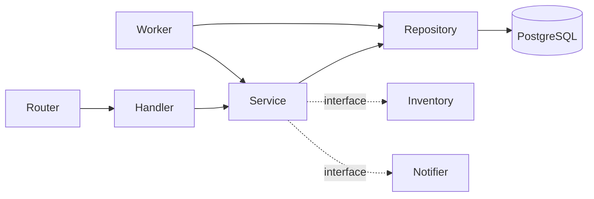

# 04 — Struktur Folder & Konvensi Kode

**Versi:** 1.0 (Tahap 1)

---

## 1. Struktur Repository

```
MANAJEMEN_HP_TEKNISI/
├── backend/
├── frontend/
├── deploy/
├── docs/
├── scripts/
├── .editorconfig
├── .gitignore
├── .env.example
├── docker-compose.yml
├── Makefile
└── README.md
```

Folder `backend`, `frontend`, `deploy`, dan file root akan dibuat pada tahap
implementasi. Dokumen ini menetapkan **target struktur** agar setiap tahap
konsisten.

---

## 2. Backend (Go + Gin + GORM)

```
backend/
├── cmd/
│   ├── api/
│   │   └── main.go                 # entrypoint HTTP server
│   ├── worker/
│   │   └── main.go                 # reminder, WA outbox, purge kredensial
│   └── cli/
│       └── main.go                 # migrate, seed, create-tenant, backup
├── internal/
│   ├── config/
│   │   ├── config.go               # load env, validasi wajib
│   │   └── config_test.go
│   ├── database/
│   │   ├── postgres.go             # pool, health check, tx helper
│   │   ├── migrate.go              # embed migrations, up/down
│   │   └── seed.go
│   ├── middleware/
│   │   ├── request_id.go
│   │   ├── recovery.go
│   │   ├── logger.go
│   │   ├── cors.go
│   │   ├── rate_limit.go
│   │   ├── auth.go
│   │   ├── tenant.go
│   │   ├── outlet.go
│   │   ├── permission.go
│   │   └── audit.go
│   ├── router/
│   │   ├── router.go               # setup Gin, middleware global
│   │   └── routes.go               # registrasi seluruh modul
│   ├── modules/
│   │   ├── auth/
│   │   ├── user/
│   │   ├── role/
│   │   ├── outlet/
│   │   ├── settings/
│   │   ├── audit/
│   │   ├── customer/
│   │   ├── device/
│   │   ├── service/
│   │   ├── inventory/
│   │   ├── invoice/
│   │   ├── payment/
│   │   ├── warranty/
│   │   ├── expense/
│   │   ├── report/
│   │   ├── dashboard/
│   │   ├── tracking/
│   │   └── notification/
│   ├── platform/                   # super admin: tenant & plan
│   │   └── tenant/
│   ├── pkg/
│   │   ├── response/               # envelope sukses/error
│   │   ├── apperror/               # error domain + kode
│   │   ├── validator/              # validator + pesan Indonesia
│   │   ├── pagination/
│   │   ├── scope/                  # TenantScope
│   │   ├── cryptoutil/             # AES-GCM, hash token
│   │   ├── jwtutil/
│   │   ├── ticket/                 # format nomor dokumen
│   │   ├── qrcode/
│   │   ├── upload/
│   │   ├── money/                  # format & round
│   │   ├── clock/                  # timezone outlet
│   │   └── logger/
│   └── jobs/
│       ├── reminder.go
│       ├── wa_outbox.go
│       └── credential_purge.go
├── migrations/
│   ├── 000001_extensions.up.sql
│   ├── 000001_extensions.down.sql
│   └── ...
├── templates/
│   ├── invoice.html                # PDF invoice
│   ├── label.html                  # label servis
│   └── wa/*.tmpl
├── uploads/                        # dev only (git-ignored)
├── tests/
│   ├── integration/
│   │   ├── auth_test.go
│   │   ├── service_flow_test.go
│   │   ├── inventory_test.go
│   │   ├── payment_test.go
│   │   └── tenant_isolation_test.go
│   └── testutil/
│       ├── db.go                   # testcontainers / DB test
│       └── factory.go              # builder data uji (bukan data produksi)
├── .golangci.yml
├── .air.toml
├── go.mod
└── go.sum
```

### 2.1 Template modul

Setiap modul memiliki 6 file wajib:

```
internal/modules/<domain>/
├── model.go
├── dto.go
├── repository.go
├── service.go
├── handler.go
├── routes.go
```

Contoh kontrak:

```go
// model.go
type ServiceOrder struct {
    ID        uuid.UUID `gorm:"type:uuid;primaryKey"`
    TenantID  uuid.UUID `gorm:"type:uuid;not null;index"`
    OutletID  uuid.UUID `gorm:"type:uuid;not null"`
    TicketNo  string    `gorm:"size:40;not null;uniqueIndex:uq_service_orders_ticket"`
    Status    string    `gorm:"size:30;not null;default:received"`
    // ...
    CreatedAt time.Time
    UpdatedAt time.Time
}

func (ServiceOrder) TableName() string { return "service_orders" }
```

```go
// routes.go
func RegisterRoutes(rg *gin.RouterGroup, h *Handler, auth gin.HandlerFunc, can func(string) gin.HandlerFunc) {
    g := rg.Group("/service-orders", auth)
    g.GET("", can("service.view"), h.List)
    g.POST("", can("service.create"), h.Create)
    g.GET("/:id", can("service.view"), h.Get)
    g.PATCH("/:id", can("service.update"), h.Update)
    g.PATCH("/:id/status", can("service.status"), h.ChangeStatus)
    g.POST("/:id/credential/reveal", can("service.credential.reveal"), h.RevealCredential)
}
```

```go
// repository.go — scope wajib
func (r *repository) FindByID(ctx context.Context, scope scope.Tenant, id uuid.UUID) (*ServiceOrder, error) {
    var m ServiceOrder
    q := r.db.WithContext(ctx).
        Where("tenant_id = ? AND id = ?", scope.TenantID, id)
    if !scope.IsOwner {
        q = q.Where("outlet_id IN ?", scope.OutletIDs)
    }
    if err := q.First(&m).Error; err != nil { /* map not found */ }
    return &m, nil
}
```

### 2.2 Aturan backend

- Tidak ada `db.Raw` dengan string yang disusun dari input pengguna; selalu
  parameter binding.
- Handler tidak mengembalikan model GORM langsung — selalu DTO.
- Semua error domain memakai `apperror.Error{Code, Message, HTTPStatus}`.
- Setiap transaksi ditutup dengan `defer tx.Rollback()` dan commit eksplisit.
- Gunakan `context.Context` dari handler sampai repository; worker memakai
  context dengan timeout.
- Logika status servis hanya di `service.ChangeStatus`; handler tidak boleh
  mengubah status langsung.
- Tidak ada `panic` untuk error bisnis.
- Query daftar selalu paginasi dan memiliki whitelist kolom sort.

### 2.3 Format response

```json
// Sukses
{ "success": true, "data": { ... }, "meta": { "page": 1, "per_page": 20, "total": 143 } }

// Error
{
  "success": false,
  "error": {
    "code": "INSUFFICIENT_STOCK",
    "message": "Stok sparepart tidak mencukupi.",
    "details": { "available": 2, "requested": 5 }
  },
  "request_id": "01J..."
}
```

---

## 3. Frontend (React + TypeScript)

```
frontend/
├── public/
│   ├── icons/                      # ikon PWA
│   └── favicon.svg
├── src/
│   ├── app/
│   │   ├── App.tsx
│   │   ├── router.tsx              # createBrowserRouter, lazy routes
│   │   ├── providers.tsx           # QueryClient, Theme, Toaster
│   │   └── error-boundary.tsx
│   ├── components/
│   │   ├── ui/                     # shadcn/ui (button, input, dialog, ...)
│   │   ├── layout/
│   │   │   ├── app-shell.tsx
│   │   │   ├── sidebar.tsx
│   │   │   ├── topbar.tsx
│   │   │   └── mobile-nav.tsx
│   │   └── shared/
│   │       ├── data-table.tsx
│   │       ├── pagination.tsx
│   │       ├── status-badge.tsx
│   │       ├── empty-state.tsx
│   │       ├── loading-skeleton.tsx
│   │       ├── error-state.tsx
│   │       ├── confirm-dialog.tsx
│   │       ├── page-header.tsx
│   │       ├── stat-card.tsx
│   │       ├── currency-input.tsx
│   │       ├── phone-input.tsx
│   │       ├── date-range-picker.tsx
│   │       └── permission-guard.tsx
│   ├── features/
│   │   ├── auth/
│   │   │   ├── api.ts
│   │   │   ├── hooks.ts
│   │   │   ├── schemas.ts
│   │   │   └── pages/login.tsx
│   │   ├── dashboard/
│   │   ├── services/
│   │   │   ├── api.ts
│   │   │   ├── hooks.ts
│   │   │   ├── schemas.ts
│   │   │   ├── constants.ts        # status, label, warna
│   │   │   ├── components/
│   │   │   │   ├── service-table.tsx
│   │   │   │   ├── service-form.tsx
│   │   │   │   ├── status-stepper.tsx
│   │   │   │   ├── status-change-dialog.tsx
│   │   │   │   ├── diagnosis-form.tsx
│   │   │   │   ├── items-editor.tsx
│   │   │   │   ├── photo-uploader.tsx
│   │   │   │   └── timeline.tsx
│   │   │   └── pages/
│   │   │       ├── service-list.tsx
│   │   │       ├── service-create.tsx
│   │   │       └── service-detail.tsx
│   │   ├── customers/
│   │   ├── inventory/
│   │   ├── invoices/
│   │   ├── payments/
│   │   ├── warranties/
│   │   ├── expenses/
│   │   ├── reports/
│   │   ├── settings/
│   │   ├── users/
│   │   ├── audit/
│   │   ├── tracking/               # halaman publik
│   │   └── print/                  # invoice, struk, label
│   ├── lib/
│   │   ├── api-client.ts           # axios + interceptor
│   │   ├── auth.ts                 # token memory, refresh
│   │   ├── permissions.ts
│   │   ├── format.ts               # rupiah, tanggal, telepon
│   │   ├── status.ts               # label & warna status
│   │   ├── constants.ts
│   │   └── utils.ts                # cn()
│   ├── stores/
│   │   ├── auth-store.ts
│   │   └── ui-store.ts             # sidebar, outlet aktif
│   ├── types/
│   │   ├── api.ts                  # envelope, pagination
│   │   └── entities.ts
│   ├── styles/
│   │   ├── globals.css             # Tailwind + token
│   │   └── print.css
│   └── main.tsx
├── e2e/
│   ├── auth.spec.ts
│   ├── service-flow.spec.ts
│   └── payment.spec.ts
├── components.json                 # konfigurasi shadcn
├── index.html
├── package.json
├── tailwind.config.ts
├── tsconfig.json
├── vite.config.ts
└── playwright.config.ts
```

### 3.1 Pola fitur

Setiap fitur memisahkan:

| File | Isi |
|---|---|
| `api.ts` | fungsi pemanggilan endpoint (tanpa state) |
| `hooks.ts` | `useQuery`/`useMutation` + invalidasi cache |
| `schemas.ts` | skema Zod + tipe form |
| `constants.ts` | label, opsi filter, warna status |
| `components/` | komponen khusus fitur |
| `pages/` | halaman route (tipis, merangkai komponen) |

### 3.2 Aturan frontend

- Tidak ada `fetch`/`axios` langsung di komponen; selalu melalui `api.ts`.
- Tidak ada angka/total yang dihitung ulang sebagai sumber kebenaran; tampilkan
  nilai dari server.
- Semua form memakai Zod dan menampilkan error per field dalam bahasa Indonesia.
- Semua mutasi menampilkan toast sukses/gagal dan menginvalidasi query terkait.
- Tombol tanpa aksi tidak boleh ada; jika fitur belum tersedia, sembunyikan
  atau beri label "Segera hadir" **hanya** di halaman non-operasional.
- Wajib menangani empat state: loading (skeleton), empty, error, success.
- Format uang dan tanggal memakai util terpusat (`format.ts`).
- Tidak menyimpan token akses di `localStorage`.

---

## 4. Deploy & Operasional

```
deploy/
├── docker/
│   ├── backend.Dockerfile          # multi-stage Go build
│   ├── frontend.Dockerfile         # build + nginx
│   └── postgres/
│       └── init.sql                # ekstensi & role aplikasi
├── nginx/
│   ├── nginx.conf                  # SPA fallback, proxy /api, security header
│   └── print.conf                  # (opsional)
├── caddy/
│   └── Caddyfile                   # TLS otomatis (opsional)
├── backup/
│   ├── backup.sh
│   ├── restore.sh
│   └── crontab
└── .env.production.example
```

Root `docker-compose.yml` mendefinisikan service: `postgres`, `migrate`,
`api`, `worker`, `web`, `backup` (profile), `caddy` (profile).
`docker-compose.override.yml` untuk development (hot reload, port DB terbuka).

`scripts/` berisi helper lintas platform:

```
scripts/
├── fixphone.ps1       # Launcher Windows: DB + API + frontend (tanpa Docker)
├── dev-db.ps1         # PostgreSQL portable (download/init/start/stop/reset)
├── restore-drill.ps1  # Backup & restore drill
├── smoke-prod.ps1     # Smoke test production (PowerShell)
├── smoke-prod.sh      # Smoke test production (bash/CI)
└── check-docs.mjs     # Validasi tautan & konsistensi dokumen
```

---

## 5. Konvensi Penamaan

| Objek | Konvensi | Contoh |
|---|---|---|
| Tabel | snake_case jamak | `service_order_items` |
| Kolom | snake_case | `estimated_done_at` |
| File Go | snake_case | `service_order.go` |
| Struct Go | PascalCase | `ServiceOrder` |
| Interface | kata benda + `-er`/peran | `Repository`, `Notifier` |
| Route API | kebab-case, jamak | `/service-orders/:id/status` |
| Payload JSON | snake_case | `estimated_done_at` |
| Komponen React | PascalCase file & nama | `ServiceStatusBadge.tsx` |
| Hook | `use` + PascalCase | `useServiceOrders` |
| Konstanta | SCREAMING_SNAKE | `SERVICE_STATUS` |
| Permission | `module.action` | `payment.create` |
| Kode error | SCREAMING_SNAKE | `INSUFFICIENT_STOCK` |
| Migrasi | 6 digit + snake_case | `000008_service_orders` |

---

## 6. Branching & Commit

- `main` selalu deployable.
- Branch fitur: `feat/service-intake`, `fix/payment-rounding`.
- Commit mengikuti Conventional Commits:
  `feat(service): add status state machine`.
- Setiap PR wajib: build lulus, lint lulus, test lulus, tidak ada `TODO` tanpa
  issue, dan update dokumentasi bila kontrak API berubah.
- Tag rilis: `v0.1.0` per tahap yang selesai diuji, `v1.0.0` untuk MVP.

---

## 7. Dependency Map (arah import yang diizinkan)



- `service` **tidak** mengimpor `handler`.
- `inventory` menyediakan interface `StockMover` untuk `service`, bukan
  sebaliknya.
- `tracking` adalah modul read-only yang memakai repository khusus dengan
  whitelist kolom publik.
- `report` boleh melakukan query agregasi langsung (read model) tanpa menulis.
